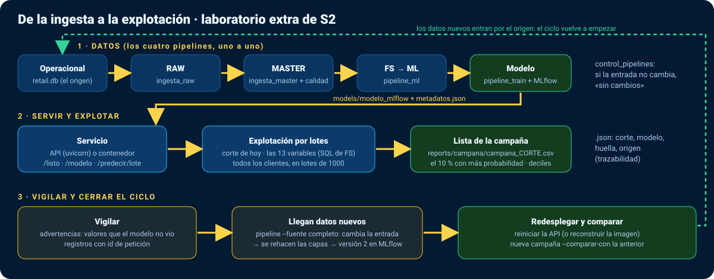

# Laboratorio extra de S2 · De la ingesta a la explotación (unos 60 min)

**Extra:** se hace si sobra tiempo en S2 o si el grupo lo pide; si no, queda como práctica para casa. No suma a la rúbrica de S2.
Recorre en una sola práctica todo lo que el curso ha ido construyendo por partes: los **pipelines de datos** (S1), el **modelo registrado** (S1), el **servicio** (S2) y lo que faltaba, **el uso del modelo por el negocio**: puntuar a todos los clientes y sacar la lista de la campaña. Termina cerrando el ciclo: llegan datos nuevos, se reentrena, sale una versión nueva y se vuelve a puntuar.



| Min | Bloque | Qué aprendes |
|---|---|---|
| 0–10 | 1. Los datos, pipeline a pipeline | Qué hace cada pipeline, qué deja y por qué la segunda vez no hace nada |
| 10–15 | 2. El modelo, registrado | Versión 1 en MLflow, con su huella de datos |
| 15–25 | 3. Ponerlo en producción | El servicio arranca, dice que está listo y qué modelo sirve |
| 25–40 | 4. Explotarlo: la campaña | Puntuar a todos los clientes «hoy» y elegir a quién llamar |
| 40–45 | 5. Vigilarlo | Lo que el modelo no vio al entrenar: la primera señal de que hay que reentrenar |
| 45–60 | 6. Cerrar el ciclo: datos nuevos | Qué se rehace solo, versión 2, redespliegue y cuánto cambia la campaña |

**Dónde.** En tu equipo (Windows, `env-ia-mlops`) o en el Codespace. Todo desde `04-Proyecto-Base`. Necesitas **dos terminales**: una para la API y otra para lo demás. El bloque 6 necesita el Excel completo de UCI (45 MB): descárgalo antes con `python -m ia_mlops.dataset descargar`.

**De dónde salen las salidas de esta guía.** De una ejecución real en Windows 11 el 13/11/2026 (`extra/capturar.py`, que lo hace todo en una carpeta temporal y guarda `extra/salidas-reales.json`). Las rutas se han recortado (`…`). Tus huellas y fechas de entrenamiento serán otras; las filas, los AUC y las cifras de la campaña deberían coincidir.

---

## 1. Los datos, pipeline a pipeline (10 min)
En S1 lanzaste `python -m ia_mlops.pipeline`, que los ejecuta todos seguidos. Ahora, uno a uno, para ver qué hace cada uno:
```bash
python -m ia_mlops.operacional               # el «sistema de ventas» de la tienda: el ORIGEN (no es un pipeline)
python -m ia_mlops.pipeline_ingesta_raw      # origen → RAW (copia fiel)
python -m ia_mlops.pipeline_ingesta_master   # RAW → MASTER (limpieza y 13 reglas de calidad)
python -m ia_mlops.pipeline_ml               # MASTER → FS (13 variables por cliente y corte) → ML (objetivo y partición)
python -m ia_mlops.pipeline_train            # ML → modelo, métricas y MLflow
```
Lo que salió (resumido):
```text
  OPERACIONAL: lineas_factura      23,070 filas
[pipeline_ingesta_raw] ejecutando (huella de entrada a3e0551c3461)
  RAW: raw_lineas_factura      23,070 filas
[pipeline_ingesta_master] ejecutando (huella de entrada d31efa33ae66)
  MASTER: master_lineas          22,117 filas
  MASTER: master_descartes          953 filas
  MASTER: calidad: 13 reglas, 1 alertas
[pipeline_ml] ejecutando (huella de entrada 16577f644dbe)
  FS: corte 2011-09-01: 131 clientes
  ML: train     626 filas | tasa de recompra 50.8 %
  ML: valid     114 filas | tasa de recompra 45.6 %
  ML: test      250 filas | tasa de recompra 40.4 %
[pipeline_train] ejecutando (huella de entrada 7108eeb2fa32)
  regresion_logistica        AUC valid 0.698 | test 0.747 | precision media test 0.659
  Mejor modelo: regresion_logistica. Guardado en …\models\modelo.joblib
  Registrado en MLflow como «retencion-90d», version 1. Para verlo: python -m ia_mlops.mlflow_ui
```
Ahora, **otra vez todo** con el orquestador:
```bash
python -m ia_mlops.pipeline
```
```text
[pipeline_ingesta_raw] sin cambios: la entrada es la misma que en la ultima ejecucion (a3e0551c3461). Usa --forzar para rehacerlo.
[pipeline_ingesta_master] sin cambios: la entrada es la misma que en la ultima ejecucion (d31efa33ae66). Usa --forzar para rehacerlo.
[pipeline_ml] sin cambios: la entrada es la misma que en la ultima ejecucion (16577f644dbe). Usa --forzar para rehacerlo.
[pipeline_train] sin cambios: la entrada es la misma que en la ultima ejecucion (7108eeb2fa32). Usa --forzar para rehacerlo.
```
Cada pipeline calcula la **huella de su entrada** (datos + código + configuración) y la apunta en la tabla `control_pipelines` de `data/processed/curso.db`. Si no cambió, no hace nada. Míralo en el visor de SQLite o con:
```bash
python -c "import sqlite3; [print(f) for f in sqlite3.connect('data/processed/curso.db').execute('SELECT pipeline, substr(huella_entrada,1,12), ejecutado_en FROM control_pipelines')]"
```
**Preguntas.** ¿Por qué el operacional no es un pipeline? ¿Qué se perdería si el entrenamiento se repitiera cada vez aunque nada cambiara (piensa en MLflow)? ¿Dónde está la regla de oro «solo datos anteriores al corte»?

## 2. El modelo, registrado (5 min)
```bash
python -m ia_mlops.mlflow_ui --comprobar
```
```text
Registro de MLflow: …\models\mlflow.db
  Experimento «retencion-90d»: 4 ejecuciones · modelo registrado «retencion-90d»: 1 versiones
```
Si quieres verlo en la web: `python -m ia_mlops.mlflow_ui`, elige **Model training** y entra en **Model registry → retencion-90d → Version 1**: verás de qué ejecución salió y su `huella_datos`. Ciérralo con Ctrl+C.

## 3. Ponerlo en producción (10 min)
**Terminal 2** (se queda ocupada con la API):
```bash
cd 04-Proyecto-Base
uvicorn ia_mlops.api.app:app --port 8080
```
*En el Codespace, en lugar de uvicorn puedes usar el contenedor del bloque 4 (`docker build …` y `docker run -d --name api -p 8080:8080 retencion-api:local`), o incluso Kubernetes con kind (guía `03-Entorno/guia-docker-kubernetes-gke/`): todo lo que sigue funciona igual contra `http://127.0.0.1:8080`.*

**Terminal 1:**
```bash
curl http://127.0.0.1:8080/listo
curl http://127.0.0.1:8080/modelo
```
```text
{"estado":"listo"}
{"modelo":"regresion_logistica", "huella_datos":"35a94deb4e04ab4a", "entrenado_en":"2026-11-13T08:00:07", "filas":{"train":626,"valid":114,"test":250}, …}
```
(En PowerShell, `curl.exe`.) La **huella** que devuelve `/modelo` es la misma que la de la versión 1 en MLflow: así se sabe qué modelo está en producción.

## 4. Explotarlo: la lista de la campaña (15 min)
El negocio no pregunta por un cliente suelto: pregunta **«¿a quién llamo esta semana?»**. Eso es puntuar a **todos** los clientes en la fecha de hoy y quedarse con los de más probabilidad. Lo hace `ia_mlops/explotacion.py`:
1. el corte de explotación es el día siguiente a la última factura (el «hoy» del dato: **2011-12-10**);
2. calcula las 13 variables de ese corte con **el mismo SQL de la capa FS** (en una tabla temporal: FS no se toca);
3. manda a todos los clientes a la API en lotes (`/predecir/lote`, hasta 1000 por petición);
4. ordena, reparte en deciles y marca la campaña: por defecto, el **10 %** con más probabilidad.
```bash
python -m ia_mlops.explotacion --url http://127.0.0.1:8080
```
```text
Corte de explotación: 2011-12-10 · modelo regresion_logistica (huella 35a94deb4e04ab4a, entrenado 2026-11-13T08:00:07)
Origen de las predicciones: http://127.0.0.1:8090
Clientes puntuados: 148 · probabilidad media 0.486
Campaña: 15 clientes (el 10% con más probabilidad), probabilidad media 0.964, mínima 0.917
Clientes con advertencias (valores que el modelo no vio al entrenar): 132
Probabilidad media por decil: 1: 0.96 · 2: 0.86 · 3: 0.73 · 4: 0.60 · 5: 0.47 · 6: 0.35 · 7: 0.29 · 8: 0.23 · 9: 0.18 · 10: 0.15
Los 10 primeros:
 puesto  cliente_id probabilidad  decil  n_advertencias
      1       13599        0.998      1               1
      2       17243        0.997      1               3
      3       12523        0.992      1               1
      4       13488        0.985      1               2
      5       18225        0.984      1               1
 …
Guardado en: …\reports\campana\campana_2011-12-10.csv y …\reports\campana\campana_2011-12-10.json
```
*(La ejecución de referencia usó el puerto 8090; tú, 8080.)* Abre `reports/campana/campana_2011-12-10.csv`: una fila por cliente, ordenada, con su decil y si entra en la campaña. El `.json` es la **trazabilidad**: qué corte, qué modelo (huella), desde dónde, cuándo. Si mañana alguien pregunta «¿por qué llamasteis a este cliente?», la respuesta está ahí.

Ahora, **sin la API**, con el modelo local:
```bash
python -m ia_mlops.explotacion --top 5
```
Debe dar **exactamente lo mismo** (en la ejecución de referencia: los mismos 148 clientes, la misma campaña de 15 y los mismos cinco primeros). Una prueba (`tests/test_explotacion.py`) lo comprueba: diferencia máxima menor que 1e-12. Es el mismo código (`ia_mlops/api/servicio.py`) en los dos caminos.

**Preguntas de negocio.**
- Si el equipo comercial solo puede llamar a 15 personas, ¿a quién llama? ¿Y si puede llamar a 30? (`--capacidad 0.2`)
- Mira la probabilidad media por decil: ¿dónde está el «codo»? ¿Merece la pena llamar al decil 5?
- La campaña tiene una probabilidad media de 0,96 frente a 0,49 de todos: ¿qué significa eso en llamadas útiles?

## 5. Vigilarlo (5 min)
132 de 148 clientes tienen **advertencias**: valores que el modelo no vio al entrenar. ¿Cuáles? (contados en el CSV de la ejecución de referencia)

| Variable fuera de rango | Clientes | Por qué |
|---|---|---|
| `antiguedad_dias` | 109 | El modelo se entrenó con cortes de **2010**; hoy es diciembre de **2011**: los clientes son más antiguos que cualquiera de los que vio |
| `dias_medios_entre_compras` no informado | 48 | Clientes con una sola compra: el modelo usa la mediana del entrenamiento (no es un error) |
| `recencia_dias` | 34 | Hay clientes sin comprar desde hace más tiempo del que había en los cortes de entrenamiento |

Esto es **deriva**: el mundo en el que se usa el modelo se ha alejado del mundo en el que se entrenó. La API no rechaza a esos clientes (son legítimos), pero avisa. Es la primera señal de que conviene **reentrenar con cortes recientes**. Los registros de la API (terminal 2) muestran además una línea JSON por lote, con su `id`: así se audita una campaña.

**Pregunta.** ¿Qué cambiarías en `ia_mlops/config.py` para entrenar con cortes de 2011? ¿Qué limita hasta dónde puedes llegar? (pista: la ventana de 90 días tiene que caber en los datos).

## 6. Cerrar el ciclo: llegan datos nuevos (15 min)
Simulamos que llega el histórico completo de ventas (1 067 371 líneas en vez de 23 070). Para la API (Ctrl+C en la terminal 2) y:
```bash
python -m ia_mlops.pipeline --fuente completo
```
Tarda unos **2 min 20 s** en Windows (142 s en la ejecución de referencia). Como la entrada cambió, **los cuatro pipelines se rehacen solos**, en orden:
```text
  MASTER: master_lineas       1,033,036 filas
  MASTER: master_descartes       34,335 filas
  MASTER: calidad: 13 reglas, 2 alertas
[pipeline_ml] ejecutando (huella de entrada 962e9788f7f6)
  ML: train  23,760 filas | tasa de recompra 48.1 %
  ML: valid   4,512 filas | tasa de recompra 35.1 %
  ML: test   10,132 filas | tasa de recompra 38.0 %
[pipeline_train] ejecutando (huella de entrada f28e1397331e)
  regresion_logistica        AUC valid 0.786 | test 0.796 | precision media test 0.735
  gradient_boosting          AUC valid 0.761 | test 0.781 | precision media test 0.718
  Mejor modelo: regresion_logistica. Guardado en …\models\modelo.joblib
  Registrado en MLflow como «retencion-90d», version 2. Para verlo: python -m ia_mlops.mlflow_ui
```
```bash
python -m ia_mlops.mlflow_ui --comprobar
```
```text
  Experimento «retencion-90d»: 8 ejecuciones · modelo registrado «retencion-90d»: 2 versiones
```
**Redesplegar.** La API carga el modelo al arrancar: vuelve a lanzarla (terminal 2: `uvicorn ia_mlops.api.app:app --port 8080`). Con el contenedor habría que **reconstruir la imagen** (`docker build …`), porque el modelo va dentro; con Kubernetes, además, `kind load` y `kubectl rollout restart deployment/retencion-api` o una etiqueta nueva. Comprueba que `/modelo` ya dice la huella nueva (`3521a0421905ba28` en la referencia, con 23 760 filas de train).

**La nueva campaña**, comparada con la de antes (guarda antes una copia del CSV de la versión 1: en PowerShell o CMD `copy reports\campana\campana_2011-12-10.csv campana_v1.csv`; en el Codespace `cp reports/campana/campana_2011-12-10.csv campana_v1.csv`):
```bash
python -m ia_mlops.explotacion --url http://127.0.0.1:8080 --comparar-con campana_v1.csv
```
```text
Corte de explotación: 2011-12-10 · modelo regresion_logistica (huella 3521a0421905ba28, entrenado 2026-11-13T08:02:40)
Clientes puntuados: 5852 · probabilidad media 0.491
Campaña: 586 clientes (el 10% con más probabilidad), probabilidad media 0.915, mínima 0.848
Clientes con advertencias (valores que el modelo no vio al entrenar): 5020
Probabilidad media por decil: 1: 0.92 · 2: 0.79 · 3: 0.68 · 4: 0.58 · 5: 0.50 · 6: 0.42 · 7: 0.35 · 8: 0.29 · 9: 0.22 · 10: 0.17
Frente a …\campana_2011-12-10_v1.csv: 13 clientes en ambas campañas, 573 nuevos, 2 que salen.
```
**Preguntas.**
- De los 15 clientes de la primera campaña, 13 siguen con el modelo nuevo. ¿Por qué hay 573 «nuevos»? (pista: ¿cuántos clientes había antes y cuántos ahora?)
- ¿Han desaparecido las advertencias de `antiguedad_dias`? ¿Por qué no, si el modelo se ha reentrenado? (pista: ¿han cambiado los cortes de entrenamiento?)
- ¿Qué pasos de este bloque harías a mano en la empresa y cuáles debería hacer un workflow? (es S4)

## Volver a la muestra
Para seguir el curso con la muestra (más rápida):
```bash
python -m ia_mlops.pipeline --fuente muestra
```
Se rehace todo otra vez y MLflow registra una versión más: el historial no se borra.

## Si algo falla
| Síntoma | Qué hacer |
|---|---|
| `No existe la capa FS` / `MASTER está vacío` | Ejecuta el bloque 1 (o `python -m ia_mlops.pipeline`). |
| `No hay modelo en …` al explotar sin `--url` | Falta entrenar: `python -m ia_mlops.pipeline_train`. |
| `Connection refused` con `--url` | La API no está arrancada en la terminal 2, o está en otro puerto. |
| `/modelo` sigue con la huella vieja tras reentrenar | No has reiniciado la API (o no has reconstruido la imagen). |
| `--fuente completo` dice que falta el archivo | `python -m ia_mlops.dataset descargar` (45 MB) y repite. |
| El bloque 6 va muy lento en el Codespace | Es normal que tarde más que en un equipo con más núcleos; si no hay tiempo, léelo con las salidas de esta guía. |

## Qué se probó y qué no
- **Probado (Windows 11, 13/11/2026):** los bloques 1 a 6 de principio a fin con la API ejecutada con uvicorn (`extra/capturar.py`), y las pruebas de `tests/test_explotacion.py` (6: el corte de hoy, que la capa FS no se toca, la campaña y su trazabilidad, API igual a local, comparar campañas y sin modelo).
- **Sin probar en este laboratorio:** el bloque 6 en el Codespace (tiempos) y el redespliegue con el contenedor o con kind (sus piezas sí: bloque 4 de S2 y la guía de Kubernetes).
