# Laboratorio Cloud Journey: la API en Google Cloud, sin claves

Vas a llevar la API de retención del caso Online Retail II desde GitHub Actions y GHCR hasta **Artifact Registry** y **Cloud Run**, entrando en Google Cloud **sin una sola clave** (*Workload Identity Federation*, WIF) y con **una persona que aprueba** el despliegue. Después pruebas la API en su URL pública, ves dónde encaja el modelo en **Vertex AI** y **lo borras todo**.

Presentación: [`index.html`](index.html) (cada orden se copia con **⧉**). Archivos de esta carpeta: [`desplegar-gcp.yml`](desplegar-gcp.yml) (el workflow), [`preparar-gcp-s4.sh`](preparar-gcp-s4.sh) (prepara Google Cloud), [`borrar-gcp-s4.sh`](borrar-gcp-s4.sh) (lo borra) y [`CONFIGURAR-GCP.md`](CONFIGURAR-GCP.md) (requisitos y ajustes, con más detalle).

> **Esta práctica usa tu cuenta de Google Cloud y puede costar dinero.** Haz el paso 10 (borrar) siempre.

> **Estado de validación.** El recorrido se hizo de verdad el 25/11/2026 con la cuenta de Google del curso y la cuenta del profesor en GitHub (`helicr`, repositorio `helicr/curso-ml-ia-desarrollo-produccion`); las capturas son de ese día. **Sin verificar:** clonar en Cloud Shell el *fork* de otra persona y las órdenes de Windows PowerShell. **Sin dato:** el coste del uso, cuánto tarda la primera llamada «en frío», cuánto tarda exactamente el despliegue del endpoint de Vertex y el importe de la prueba gratuita. `borrar-gcp-s4.sh` y la práctica 04 **sí se ejecutaron** el 25/11/2026 (capturas `cj-08`, `cj-06` y `cj-07`).

Cada paso dice **dónde** se ejecuta: **Cloud Shell**, **tu terminal** (o el Codespace), **la web de GitHub** o **la consola de Google Cloud**.

---

## 0. De dónde partimos y adónde vamos

**AS-IS (hoy).** La API se construye y se prueba en GitHub Actions y se publica en GHCR, con la aprobación del *environment* `produccion`. Se ejecuta en tu equipo o en el Codespace; MLflow y SQLite son locales. No hay nada en Google Cloud.

**TO-BE (mañana).** La imagen va a **Artifact Registry**; la API corre en **Cloud Run**; GitHub Actions despliega **sin claves (WIF)** y con la **misma aprobación humana**; el **modelo** se registra y se sirve en **Vertex AI** (Model Registry y endpoint: es la práctica 04); los datos y el modelo viven en **Cloud Storage**.

| Pieza | Hoy | Mañana | Servicio |
|---|---|---|---|
| Imagen de la API | GHCR (`ghcr.io`) | repositorio `curso` | **Artifact Registry** |
| La API | tu equipo o el Codespace | URL pública que **escala a cero** | **Cloud Run** |
| Entrada de GitHub a la nube | no existe todavía | identidad federada, **sin claves** | **Workload Identity Federation** + cuenta de servicio |
| Quién ejecuta el servicio | tu usuario | cuenta `sa-cloudrun-retencion`, **sin roles** | **IAM** (cuentas de servicio) |
| Publicación | Actions + aprobación | igual: **la misma aprobación** | GitHub Actions (environment `produccion`) |
| Modelo registrado y servido | MLflow local y la imagen | Model Registry + endpoint | **Vertex AI** (práctica 04) |
| Datos y archivos | `data/` y SQLite locales | un bucket (el del modelo, en la práctica 04) | **Cloud Storage** |
| Control del gasto | nada que controlar | presupuesto de **20 €** con alertas | **Presupuestos de facturación** |

| Palabra | Qué es |
|---|---|
| **Cloud Shell** | una terminal de Linux que Google te da en el navegador, ya con `gcloud` y con tu proyecto elegido |
| **Artifact Registry** | el almacén de imágenes de contenedor de Google Cloud (el equivalente de GHCR) |
| **Cloud Run** | ejecuta un contenedor y le da una URL pública; con `min-instances=0` no hay nada encendido cuando nadie lo llama |
| **Cuenta de servicio** | la «identidad» de un programa. Aquí hay dos: una que **despliega** (la usa GitHub) y otra con la que **corre** la API, sin ningún permiso |
| **WIF** | *Workload Identity Federation*: GitHub demuestra quién es con un token de corta vida y recibe acceso temporal, sin guardar claves |
| **OIDC** | *OpenID Connect*: la forma estándar de demostrar quién eres con un token firmado |
| **Región** | dónde están los recursos: `southamerica-west1` es Santiago, la más cercana a Perú |
| **Vertex AI** | la plataforma de IA de Google Cloud: Model Registry (registro de modelos) y endpoint (el modelo servido) |

---

## 1. Requisitos (la consola de Google Cloud)

- Una **cuenta de Google** con Google Cloud activado (prueba gratuita). Importe y duración de la prueba: **sin verificar**, consúltalo en la oferta vigente.
- Un **proyecto**. El del curso es `project-curso-ml-ia`; el tuyo puede tener **otro ID**: úsalo donde aquí aparezca el del profesor.
- La región **`southamerica-west1`** (Santiago).
- Una **cuenta de facturación** activa (menú ☰ › **Facturación**). Apunta su **ID**.
- Tu *fork* de `curso-ml-ia-desarrollo-produccion` con la carpeta de este laboratorio y el *environment* `produccion` con revisores (laboratorio anterior: `../laboratorio-produccion-e2e/CONFIGURAR-REPOSITORIO.md`).

| La lista de proyectos | La cuenta de facturación | El proyecto, sin facturación |
|---|---|---|
| 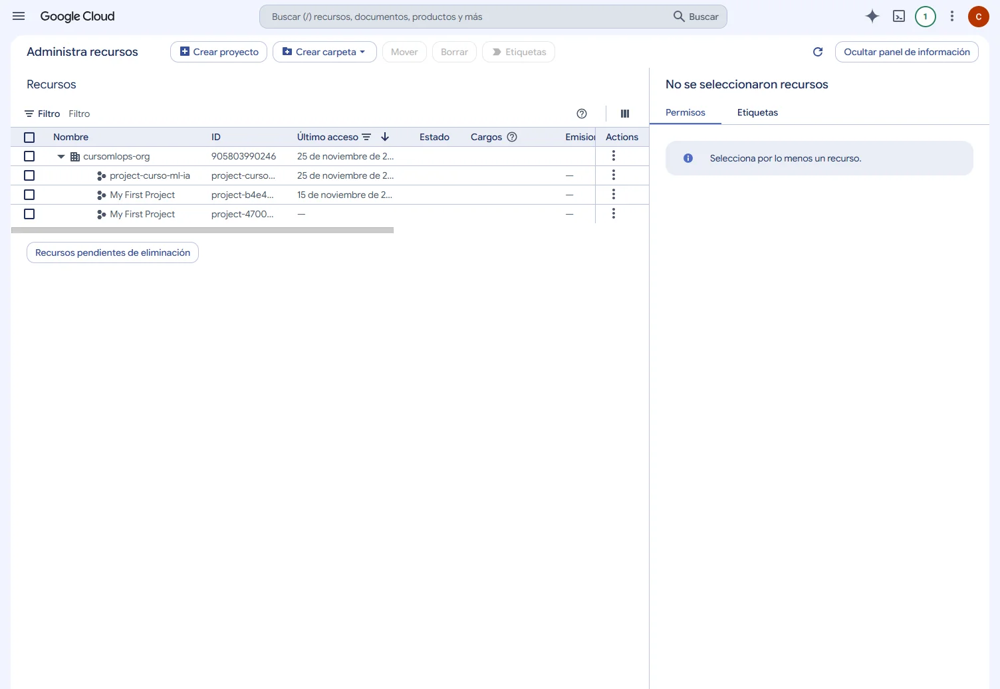 | 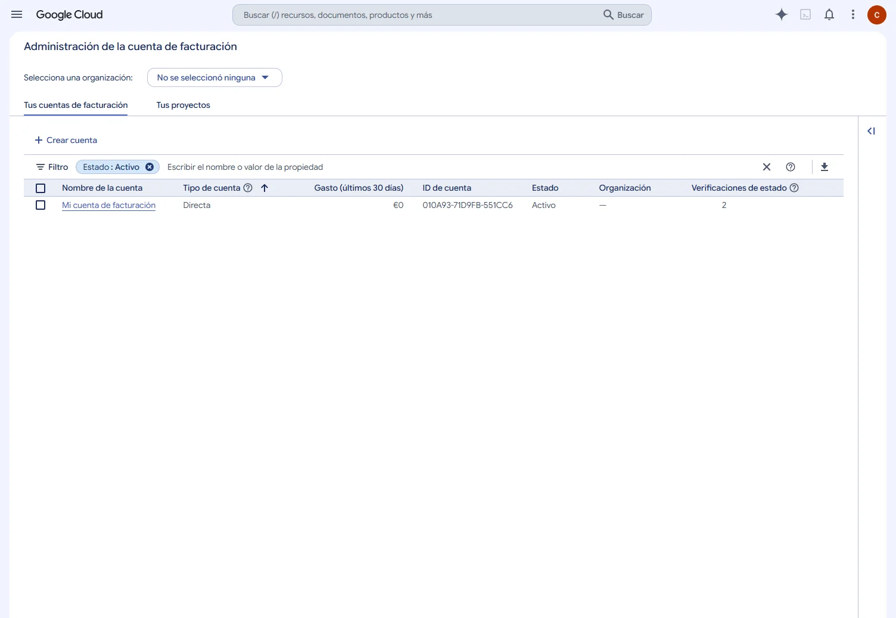 | 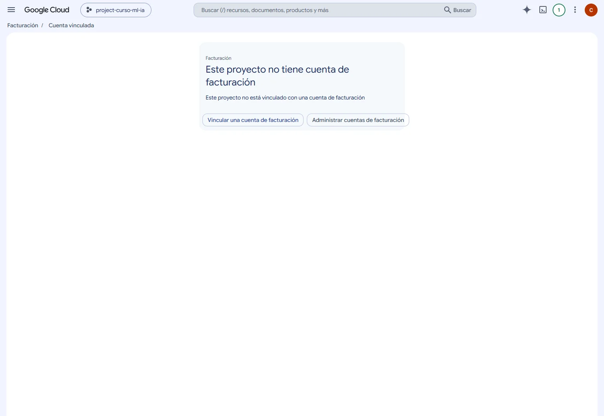 |

**Qué debes ver.** Tu proyecto en la lista y una cuenta de facturación **Activa**. Un proyecto recién creado **no tiene facturación** («Este proyecto no tiene cuenta de facturación»): no hace falta vincularla a mano, lo hace el script del paso 3.

---

## 2. Abrir Cloud Shell (la consola de Google Cloud)

1. Entra con la cuenta de Google del curso y comprueba arriba que está elegido tu proyecto.
2. Pulsa el icono **>_** (Activar Cloud Shell), arriba a la derecha.
3. Espera a que salga el prompt.

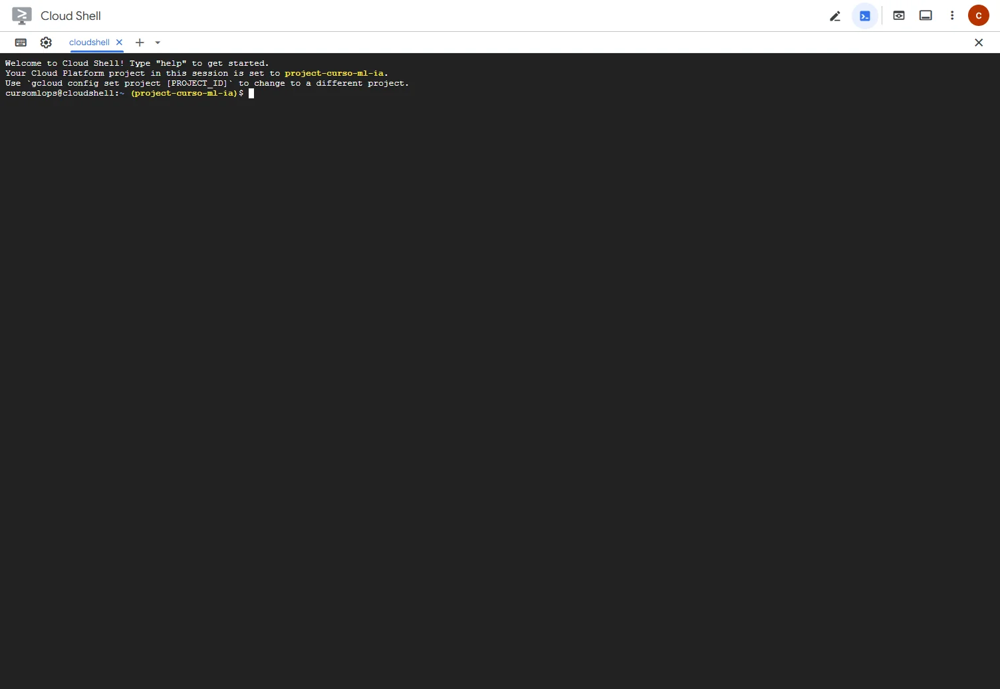

**Qué debes ver.** «Your Cloud Platform project in this session is set to project-curso-ml-ia» (con tu ID) y el prompt con el proyecto entre paréntesis.

**Si falla.** Si el proyecto que sale no es el tuyo: `gcloud config set project <tu-ID-de-proyecto>`.

---

## 3. Preparar Google Cloud con el script (Cloud Shell)

### 3.1 Traer el script y poner tus tres valores

En **Cloud Shell**, una orden cada vez. Cambia solo `tu-usuario-de-github` en la primera:

```bash
USUARIO_GH=tu-usuario-de-github
```

```bash
git clone -q --depth 1 -b develop https://github.com/$USUARIO_GH/curso-ml-ia-desarrollo-produccion.git curso
```

```bash
cd ~/curso/01-Sesiones/S4-Orquestacion-y-CI-CD/laboratorio-cloud-journey
```

Apunta el **ACCOUNT_ID** de tu cuenta de facturación:

```bash
gcloud billing accounts list
```

Edita las tres líneas del principio del script (`nano`: **Ctrl+O**, **Intro** para guardar y **Ctrl+X** para salir):

```bash
nano preparar-gcp-s4.sh
```

| Línea | Pon |
|---|---|
| `PROYECTO=` | el **ID** de tu proyecto |
| `FACTURACION=` | el **ACCOUNT_ID** de `gcloud billing accounts list` |
| `REPO_GITHUB=` | `tu-usuario/curso-ml-ia-desarrollo-produccion` |

El resto (región, nombres de las cuentas, pool) **no se toca**. Comprueba el resultado:

```bash
grep -nE '^(PROYECTO|FACTURACION|REPO_GITHUB)=' preparar-gcp-s4.sh
```

**Qué debes ver.** Solo esas tres líneas, ya con tus valores.

**Si falla.**
- `Remote branch develop not found` o `Repository not found`: tu *fork* no tiene `develop` o escribiste mal el usuario. (Clonar el *fork* de otra persona en Cloud Shell: **sin verificar**; con el del profesor sí se hizo.)
- `destination path 'curso' already exists`: ya lo clonaste; haz `cd ~/curso` y `git pull`.

### 3.2 Ejecutar el script

```bash
bash preparar-gcp-s4.sh
```

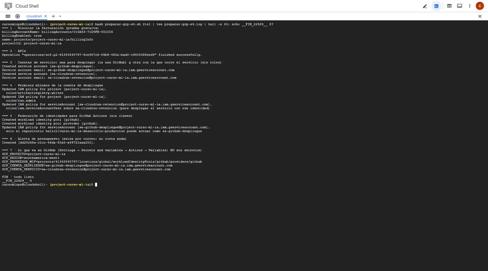

**Qué debes ver.** Siete bloques «=== n · …» y al final **«FIN · todo listo»**. Antes del final salen **cinco líneas `GCP_…=`**: son tus variables de GitHub. **Cópialas.** (En la captura aparece además un marcador `__FIN_… 0` que añadió la herramienta con la que se tecleó la orden: tú solo verás «FIN · todo listo».)

**Si falla.** `PERMISSION_DENIED` al vincular la facturación: tu cuenta no administra esa cuenta de facturación. Un error en un bloque **detiene** el script: corrige y vuelve a ejecutarlo; lo que ya existe no se vuelve a crear.

**Si lo repites un día después de borrarlo.** Visto el 26/11/2026: el bloque 5 daba `ERROR: (gcloud.iam.workload-identity-pools.providers.create-oidc) NOT_FOUND: Requested entity was not found`. Google **no borra del todo** un pool de identidades ni su proveedor: los guarda **30 días** en estado `DELETED` y no deja reutilizar el nombre. El script de esta carpeta ya lo detecta y los restaura solo (verás «estaba borrado: lo restauro»). Si usas una copia antigua del script, se hace a mano en Cloud Shell:

```bash
gcloud iam workload-identity-pools describe github --location=global --format='value(state)'
gcloud iam workload-identity-pools undelete github --location=global
gcloud iam workload-identity-pools providers undelete github --workload-identity-pool=github --location=global
```

El primer comando debe decir `DELETED`; después de los otros dos, `ACTIVE`. Repite entonces el script.

### 3.3 Qué dejó hecho el script

| Bloque | Qué hace | Por qué |
|---|---|---|
| **1 · Facturación** | vincula la cuenta de facturación al proyecto | sin ella no se pueden activar las APIs de pago |
| **2 · APIs** | activa Artifact Registry, Cloud Run, IAM, credenciales, STS, Resource Manager y Presupuestos | cada servicio se activa una vez por proyecto |
| **3 · Cuentas** | `sa-github-despliegue` (la usa GitHub) y `sa-cloudrun-retencion` (con la que corre la API) | separar quien **despliega** de quien **ejecuta** |
| **4 · Permisos mínimos** | al desplegador: `artifactregistry.writer`, `run.admin` y `serviceAccountUser` **solo sobre** `sa-cloudrun-retencion` | puede subir imágenes y desplegar, nada más; la cuenta del servicio **no tiene ningún rol** |
| **5 · Federación (WIF)** | pool `github`, proveedor `github` y una **condición** que limita a tu repositorio | cualquier otro repositorio de GitHub queda **rechazado** |
| **6 · Presupuesto** | alerta de **20 €** al 50, 90 y 100 % | avisa por correo; **no corta** nada |
| **7 · Variables** | imprime las cinco `GCP_…` | son lo que necesita el workflow |

### 3.4 Por qué sin claves

En esta organización una política heredada, `iam.disableServiceAccountKeyCreation`, impide crear claves de cuentas de servicio. Es una buena práctica general: una clave JSON es una contraseña que no caduca. WIF evita la clave: cada ejecución de Actions pide a GitHub un token **OIDC** que dice de qué repositorio es; Google lo valida contra el pool, el proveedor y la condición del repositorio y, solo si cuadra, entrega acceso **temporal** como `sa-github-despliegue`.

| La política (Aplicada, heredada) | Las cuentas, antes del script: «No hay claves» | Workload Identity, antes del script |
|---|---|---|
| 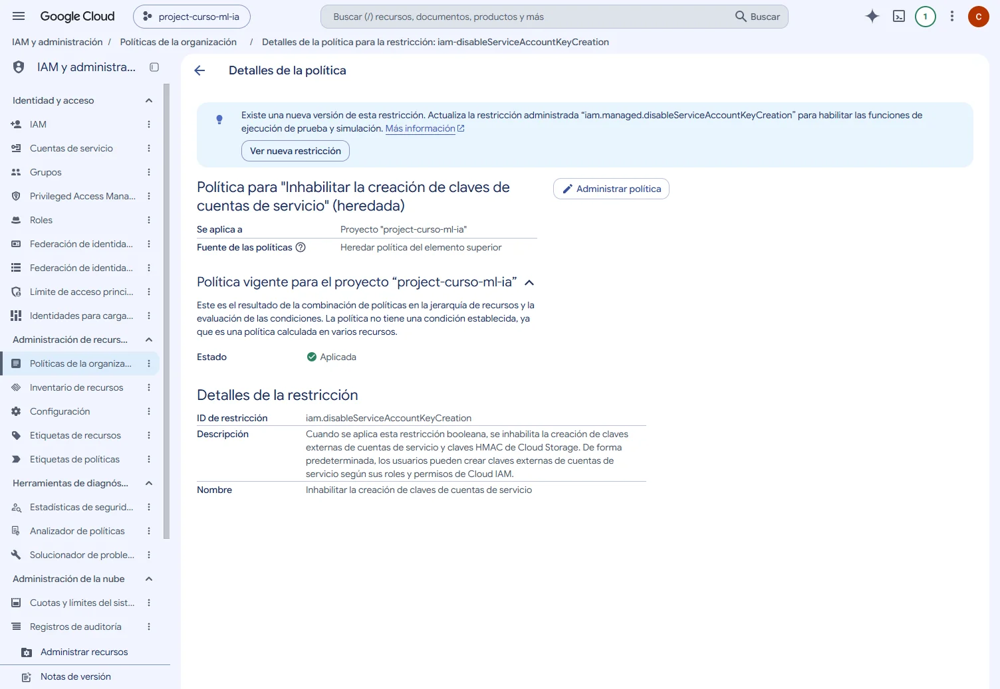 | 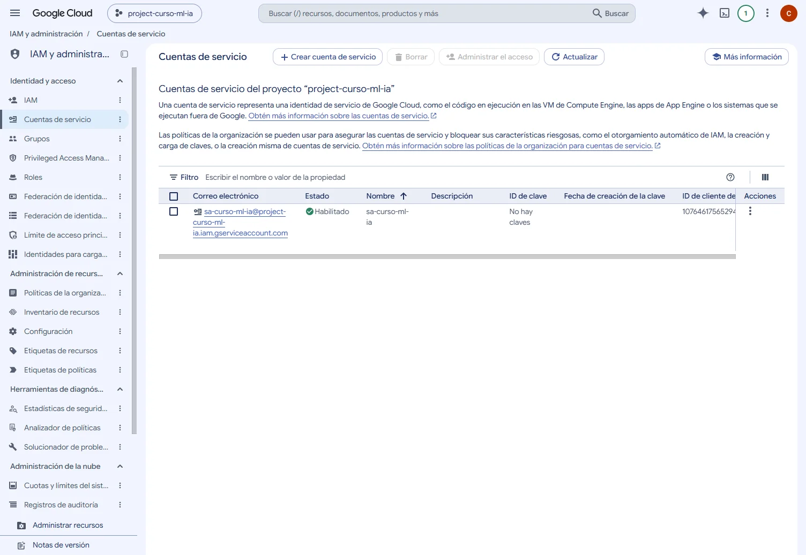 | 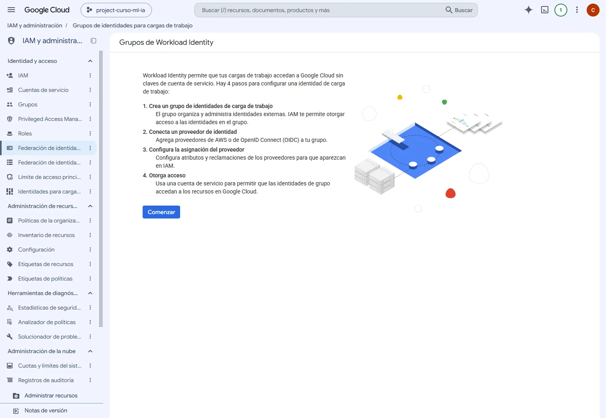 |

---

## 4. Crear el repositorio de Artifact Registry (Cloud Shell)

El script no crea el repositorio de imágenes. **Escribe la descripción sin tildes**: al teclear en Cloud Shell desde otra herramienta se perdieron («Imgenes», se ve en la captura).

```bash
gcloud artifacts repositories create curso --repository-format=docker --location=southamerica-west1 --description="Imagenes del curso"
```

```bash
gcloud artifacts repositories list --location=southamerica-west1
```

Opcional: comprueba que la organización deja publicar una URL sin login (la API se despliega con `--allow-unauthenticated`):

```bash
gcloud resource-manager org-policies describe iam.allowedPolicyMemberDomains --project=project-curso-ml-ia --effective
```

![Cloud Shell: «Created repository [curso]», la política con allValues: ALLOW y Vertex AI respondiendo en southamerica-west1](img/gcp-24-ar-y-politicas.webp)

**Qué debes ver.** `Created repository [curso].`; el repositorio `curso` en la lista y, en la política, `allValues: ALLOW`. (La captura reúne en una sola línea tres comprobaciones: el repositorio, la política y que Vertex AI responde en Santiago: «Listed 0 items».)

**Si falla.** Si la política **no** permite `allUsers`, el despliegue con `--allow-unauthenticated` puede fallar o la URL no ser pública (**sin verificar**: aquí sí lo permite).

---

## 5. Las cinco variables de GitHub (la web de GitHub)

En **tu *fork*** de GitHub: **Settings** › **Secrets and variables** › **Actions** › pestaña **Variables** › **New repository variable**. Escribe **Name** y **Value** y pulsa **Add variable**; repítelo cinco veces. Son **variables** (no secretos): no hay nada secreto.

| Name | Value (las del profesor) |
|---|---|
| `GCP_PROYECTO` | `project-curso-ml-ia` |
| `GCP_REGION` | `southamerica-west1` |
| `GCP_PROVEEDOR_WIF` | `projects/61343545797/locations/global/workloadIdentityPools/github/providers/github` |
| `GCP_CUENTA_DESPLIEGUE` | `sa-github-despliegue@project-curso-ml-ia.iam.gserviceaccount.com` |
| `GCP_CUENTA_SERVICIO` | `sa-cloudrun-retencion@project-curso-ml-ia.iam.gserviceaccount.com` |

**Tus valores son los que imprimió tu script** (líneas `GCP_…=`).

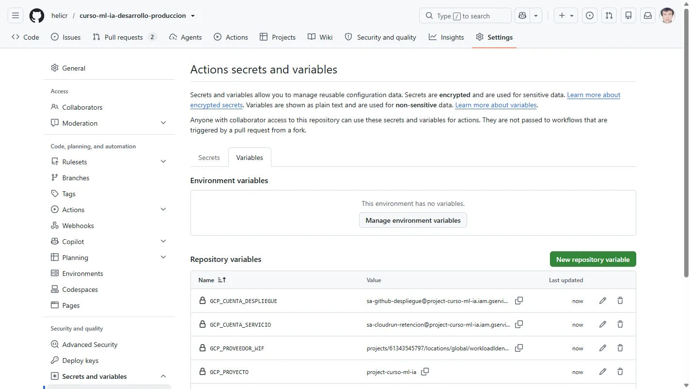

**Qué debes ver.** Las cinco en **Repository variables** (no en «Environment variables»).

---

## 6. El workflow y el ensayo (tu terminal o el Codespace)

### 6.1 Qué hace `desplegar-gcp.yml`

Dos trabajos con una aprobación entre ellos:

1. **Construir y probar la imagen**: entrena con la muestra del repositorio, construye la imagen y la prueba en el runner (`/salud`, `/listo`, `/modelo` y una predicción). Si algo falla, **no se publica nada**. Guarda la imagen como artefacto.
2. **Publicar en Artifact Registry y desplegar en Cloud Run**: espera la aprobación del *environment* `produccion`, carga **la misma imagen**, entra en Google Cloud sin claves, la sube, la despliega y prueba la URL pública. Deja un resumen con la imagen y la URL.

| Línea | Qué hace |
|---|---|
| `on: push: branches: ['lab/cloud-journey/**']` | un push a una rama `lab/cloud-journey/…` lo lanza: ensayo **sin tocar** `develop` ni `main` (también hay `workflow_dispatch`) |
| `permissions: id-token: write` (trabajo 2) | deja que GitHub emita el **token OIDC**; sin él no hay WIF |
| `environment: produccion` | el trabajo **espera** a que una persona apruebe |
| `google-github-actions/auth@v2` con `workload_identity_provider` y `service_account` | cambia el token de GitHub por **acceso temporal** como `sa-github-despliegue` |
| `google-github-actions/setup-gcloud@v2` | instala `gcloud` en el runner |
| `gcloud auth configure-docker …-docker.pkg.dev` y `docker push` | Docker entra en Artifact Registry con ese acceso y **sube la imagen** |
| `gcloud run deploy … --service-account=…` | el servicio **corre con la cuenta sin permisos** |
| `--min-instances=0 --max-instances=1 --allow-unauthenticated` | escala a **cero** y a **uno** como máximo; URL **pública** |
| `defaults.run.working-directory: .` (trabajo 2) | ese trabajo **no hace checkout** y no puede heredar `04-Proyecto-Base` (lección de S4) |

### 6.2 Copiar el workflow y lanzar el ensayo

En **tu terminal (bash) o la del Codespace**, en la raíz del repositorio y **una orden por línea** (en Windows PowerShell 5.1 `&&` no existe):

```bash
git switch develop
```

```bash
git pull
```

```bash
git switch -c lab/cloud-journey/despliegue
```

```bash
mkdir -p .github/workflows
```

```bash
cp 01-Sesiones/S4-Orquestacion-y-CI-CD/laboratorio-cloud-journey/desplegar-gcp.yml .github/workflows/
```

```bash
git add .github/workflows/desplegar-gcp.yml
```

```bash
git commit -m "Ensayo Cloud Journey: desplegar la API en Cloud Run con WIF"
```

```bash
git push -u origin lab/cloud-journey/despliegue
```

En **Windows PowerShell 5.1** (**sin verificar**), en lugar de `mkdir -p` y `cp`:

```powershell
New-Item -ItemType Directory -Force .github/workflows
```

```powershell
Copy-Item 01-Sesiones/S4-Orquestacion-y-CI-CD/laboratorio-cloud-journey/desplegar-gcp.yml .github/workflows/
```

**Qué debes ver.** `Switched to a new branch 'lab/cloud-journey/despliegue'` y, tras el `push`, una línea `[new branch]`. En la pestaña **Actions** de GitHub aparece un run nuevo: **Cloud Journey · desplegar la API en Google Cloud**.

**Si falla.** No aparece ningún run: Actions sin activar en el *fork*, o la rama **no empieza por** `lab/cloud-journey/`. Antes de este paso deben existir las cinco variables (paso 5) y el *environment* `produccion` con revisores.

---

## 7. Aprobar el despliegue (la web de GitHub)

1. **Actions** › abre el run. El trabajo 1 se pone en verde y el 2 queda en **Waiting**.
2. Pulsa **Review deployments** (aviso amarillo: «**helicr requested your review to deploy to produccion**», con tu usuario).
3. Marca **produccion**.
4. Pulsa **Approve and deploy**.

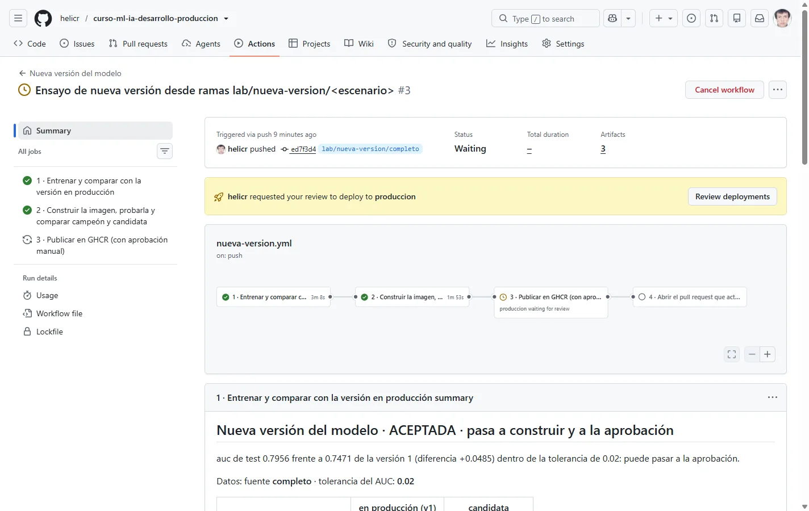

*Esta captura es del laboratorio anterior (otro workflow); el aviso y el botón son los mismos.* Si el trabajo 2 pasa **sin pedir aprobación**, el *environment* `produccion` no existe o no tiene revisores: repite `CONFIGURAR-REPOSITORIO.md` del laboratorio anterior.

**El resultado real (run nº 45519881368).** Verde, **8 min 32 s** en total (incluye la espera de la aprobación); trabajo 1 «Construir y probar la imagen» **1 min 49 s**; trabajo 2 «Publicar en Artifact Registry y desplegar en Cloud Run» **1 min 16 s**. Se abre con `https://github.com/helicr/curso-ml-ia-desarrollo-produccion/actions/runs/45519881368`; los tuyos serán otros.

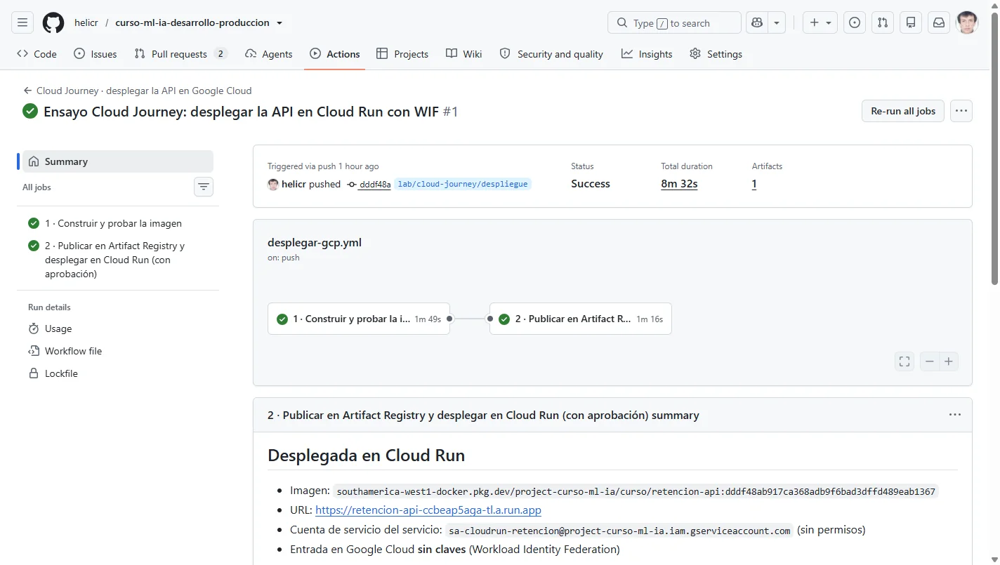

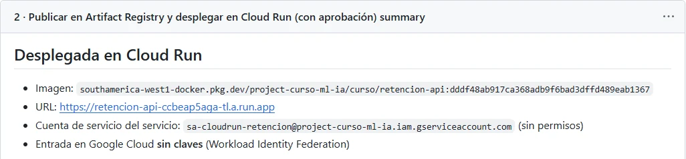

**Qué debes ver.** En el resumen del trabajo 2: la imagen `southamerica-west1-docker.pkg.dev/project-curso-ml-ia/curso/retencion-api:<commit>`, la **URL** de `run.app`, la cuenta `sa-cloudrun-retencion` «(sin permisos)» y «Entrada en Google Cloud sin claves».

---

## 8. Probar la API (desde cualquier sitio)

En **Cloud Shell** saca tu URL con la misma orden que usa el workflow y entra en la carpeta del proyecto:

```bash
URL=$(gcloud run services describe retencion-api --region=southamerica-west1 --format='value(status.url)')
```

```bash
cd ~/curso/04-Proyecto-Base
```

Con la variable `URL` puesta (Cloud Shell, bash o tu terminal; en tu terminal copia la URL del resumen del run):

```bash
curl -fsS "$URL/salud"
```

```bash
curl -fsS "$URL/listo"
```

```bash
curl -fsS -X POST "$URL/predecir" -H 'content-type: application/json' -d @tests/datos/cliente_ejemplo.json
```

En **Windows PowerShell 5.1**, en la raíz del repositorio (**sin verificar**; cambia `XXXX` por tu URL):

```powershell
$URL = "https://retencion-api-XXXX.a.run.app"
```

```powershell
Invoke-WebRequest -UseBasicParsing "$URL/salud" | Select-Object -ExpandProperty Content
```

```powershell
Invoke-WebRequest -UseBasicParsing "$URL/listo" | Select-Object -ExpandProperty Content
```

```powershell
Invoke-WebRequest -UseBasicParsing -Method Post -Uri "$URL/predecir" -ContentType "application/json" -InFile 04-Proyecto-Base/tests/datos/cliente_ejemplo.json | Select-Object -ExpandProperty Content
```

**Qué debes ver.**
- `/salud` → `{"estado":"ok"}`
- `/listo` → `{"estado":"listo"}`
- `/predecir` → `{"probabilidad":0.8278889191932133,"modelo":"regresion_logistica","huella_datos":"35a94deb4e04ab4a","advertencias":[]}`

Es **la misma probabilidad que en local** (0,828), con la misma huella de datos.

**Si falla.** La primera llamada tarda más: el servicio arranca desde cero (`min-instances=0`); reintenta (cuánto tarda: **sin dato**). Un `403` podría ser que la organización no permite `allUsers` (paso 4; **sin verificar**).

**En la consola:** menú ☰ › **Cloud Run** › `retencion-api` (región `southamerica-west1`, con la marca verde, su URL y, en *Observabilidad*, las métricas) y menú ☰ › **Artifact Registry** › `curso` › `retencion-api` (tres versiones: una con la etiqueta del commit y otra de 174,8 MB).

| 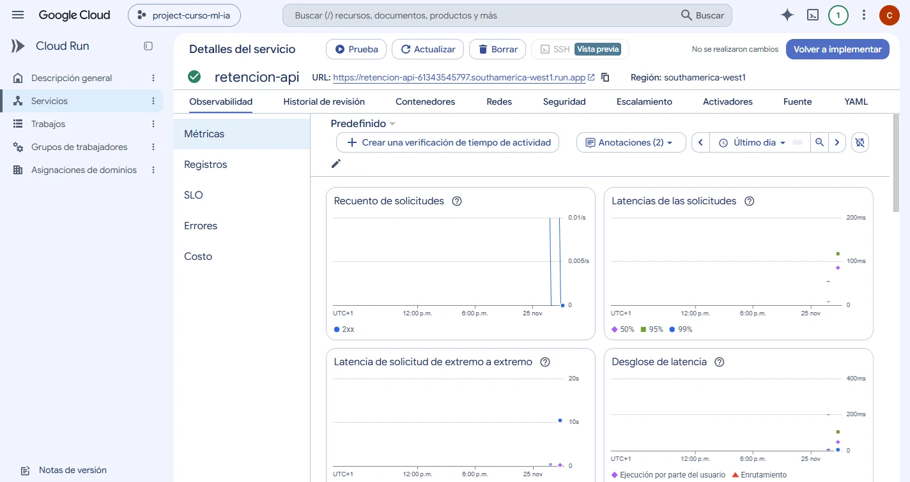 | 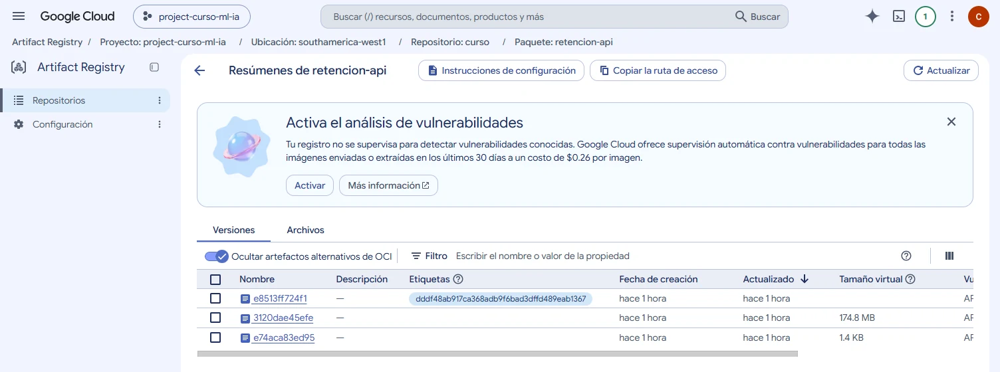 |
|---|---|

---

## 9. El modelo en Vertex AI (Cloud Shell, práctica 04)

El TO-BE del modelo es la **práctica 04**: [`../practicas-gcp/04-vertex-modelo/README.md`](../practicas-gcp/04-vertex-modelo/README.md). Aquí solo se resume. Se hace aparte y tarda.

```bash
cd ~/curso/01-Sesiones/S4-Orquestacion-y-CI-CD/practicas-gcp/04-vertex-modelo
```

```bash
bash crear.sh
```

```bash
bash probar.sh
```

En cuanto acabes (el endpoint **cobra mientras tenga un modelo desplegado**, aunque no reciba peticiones):

```bash
bash borrar.sh
```

- `crear.sh` **reentrena el mismo modelo** con scikit-learn 1.6.1: los contenedores pre-construidos de Vertex solo llegan a la 1.6 y el proyecto usa la 1.9.1.
- Crea un bucket, registra **`retencion-90d-sklearn`** en el Model Registry y despliega el endpoint **`retencion-90d-endpoint`** (1 réplica `e2-standard-2`).
- La petición es `{"instances": [[13 números]]}`: una lista en el orden del modelo, no un diccionario.
- Comprobado el 25/11/2026: el contenedor devuelve la **clase** (1 o 0), no la probabilidad. El despliegue tardó del orden de 10-15 min (**sin medir** con exactitud). Coste: **sin dato**.
- Dónde verlo: menú ☰ › **Plataforma de Gemini** (Vertex AI) › **Modelos** › **Registro de modelos** y **Extremos** (los *endpoints*), con la región `southamerica-west1` elegida: en otra región la lista sale vacía.

| 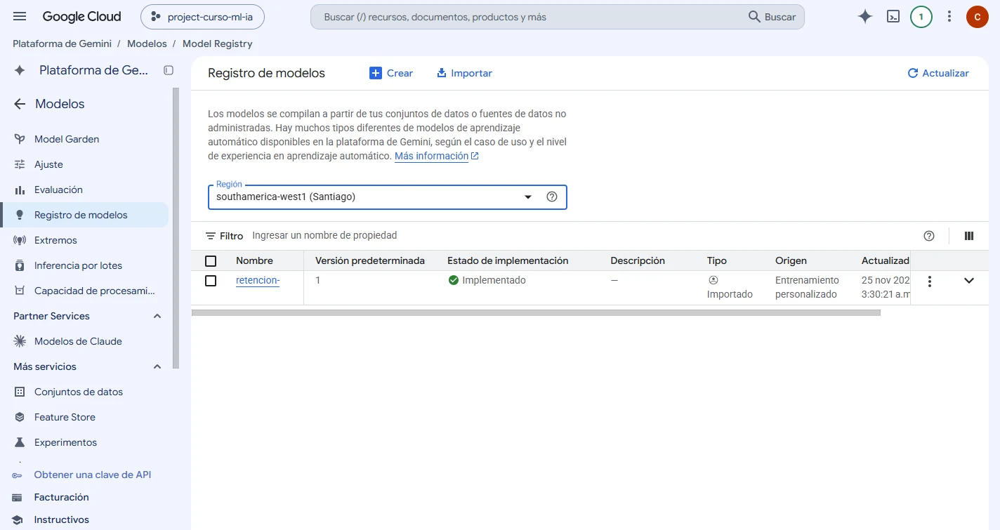 | 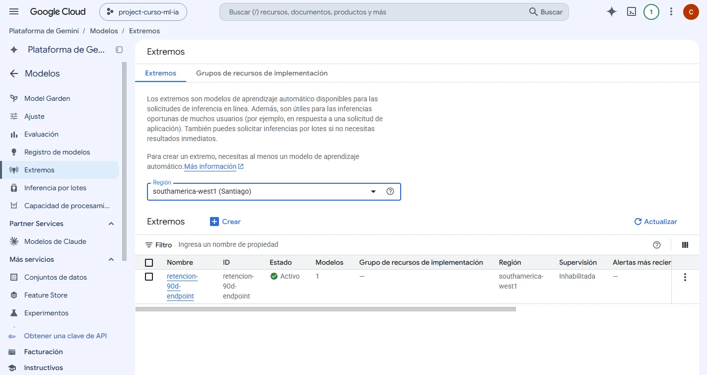 |
|---|---|

---

## 10. Borrar todo (Cloud Shell)

**Sin este paso, lo creado sigue ahí y puede seguir cobrando.** Primero la práctica 04, si la hiciste:

```bash
cd ~/curso/01-Sesiones/S4-Orquestacion-y-CI-CD/practicas-gcp/04-vertex-modelo
```

```bash
bash borrar.sh
```

Después, este laboratorio:

```bash
cd ~/curso/01-Sesiones/S4-Orquestacion-y-CI-CD/laboratorio-cloud-journey
```

```bash
bash borrar-gcp-s4.sh
```

Opcional, para desvincular además la facturación del proyecto:

```bash
DESVINCULAR_FACTURACION=si bash borrar-gcp-s4.sh
```

**Qué borra:** el servicio `retencion-api` de Cloud Run, el repositorio `curso` con sus imágenes, los permisos y las dos cuentas del laboratorio (`sa-github-despliegue` y `sa-cloudrun-retencion`), el proveedor y el pool de WIF y el presupuesto «Curso ML e IA». **No borra** el proyecto ni la cuenta `sa-curso-ml-ia` (ya existía) ni las APIs activadas (no cuestan nada).

**Qué debes ver.** Cada bloque dice qué borra o «No existe (nada que borrar)» (se puede repetir); al final, listados **vacíos** (Cloud Run, Artifact Registry, pools de WIF y presupuestos), solo `sa-curso-ml-ia` entre las cuentas de servicio, y la última línea «**FIN · borrado terminado**». Captura real del final del borrado (solo se ven los pasos 5 a 8; la captura recorta los anteriores):

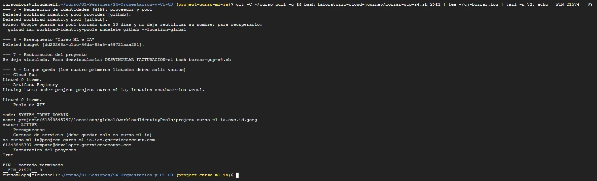

**Si falla / a mano.**
- Google guarda un pool de WIF borrado unos **30 días** y no deja reutilizar su nombre (según su documentación; **sin verificar aquí**). Para recuperarlo: `gcloud iam workload-identity-pools undelete github --location=global`.
- Las cinco variables de GitHub se borran **a mano**: Settings › Secrets and variables › Actions › Variables.
- Revisa siempre los listados finales y, si algo queda, bórralo desde la consola de Google Cloud. En la cuenta del curso el script se ejecutó de verdad el 25/11/2026 y dejó los listados vacíos.

---

## 11. Costes y lecciones reales

- **`min-instances=0`**: no hay nada encendido cuando nadie llama; `--max-instances=1` pone un tope. Importe del uso: **sin dato**.
- **Presupuesto de 20 €** con alertas al 50, 90 y 100 %: avisa, **no corta nada**.
- **Sin claves, por política**: la organización prohíbe crear claves de cuentas de servicio; WIF es la vía que queda.
- **La cuenta de Compute, sin roles**: en una organización nueva, la cuenta de servicio de Compute **no tiene ningún rol**; con ella GKE se rompió (práctica 02).
- **Gemini no está en Santiago**: para Gemini se usa la ubicación `global` (práctica 05); el resto va en `southamerica-west1`.
- **Tildes en Cloud Shell**: al teclear desde otra herramienta se perdieron («Imgenes»): descripciones de `gcloud` **sin tildes**.

## 12. Si algo falla

| Síntoma | Causa | Qué hacer | ¿Visto? |
|---|---|---|---|
| Aparece «Imgenes» en la descripción | Se pierden las tildes al teclear en Cloud Shell | Escribir sin tildes | sí (25/11) |
| El trabajo 2 falla con «No such file or directory» | Un trabajo **sin checkout** hereda `working-directory: 04-Proyecto-Base` | `working-directory: .` en ese trabajo (ya está) | sí (S4) |
| El trabajo 2 pasa **sin esperar** | El *environment* `produccion` no existe o está **sin revisores** | Configurarlo (laboratorio anterior) | sí (S4) |
| No aparece ningún run | Actions sin activar en el *fork*, o rama que no empieza por `lab/cloud-journey/` | Pestaña Actions; revisar el nombre de la rama | sin verificar |
| Falla el paso «Entrar en Google Cloud sin claves» | Variables mal copiadas, o `REPO_GITHUB` del script distinto de tu repositorio | Repasar las cinco variables y la condición del proveedor | sin verificar |
| Falla `docker push` o `gcloud run deploy` | Falta el repositorio `curso` (paso 4), una API o un permiso | Repetir el paso 4; volver a ejecutar el script | sin verificar |
| La URL responde `403` | Posible: la organización no permite `allUsers` | La orden de política del paso 4 | sin verificar |

## 13. Qué se comprobó de verdad y qué falta

**Comprobado el 25/11/2026 en la cuenta del curso:** el run nº 45519881368 en verde (8 min 32 s en total, trabajos de 1 min 49 s y 1 min 16 s); la API en Cloud Run con `/salud`, `/listo` y `/predecir` (0,8278889191932133, igual que en local); el script `preparar-gcp-s4.sh` de principio a fin («FIN · todo listo») y el repositorio `curso`; las cinco variables y la entrada sin claves.

También **comprobado:** `borrar-gcp-s4.sh` ejecutado (WIF y presupuesto borrados, listados vacíos, quedan solo `sa-curso-ml-ia` y la cuenta de Compute por defecto) y la práctica 04 con el modelo en el Registro y el endpoint Activo en Santiago.

**Sin verificar o sin dato:** clonar el *fork* de otra persona en Cloud Shell; las órdenes de PowerShell; el coste del uso, el tiempo de la primera llamada en frío, el tiempo exacto del despliegue del endpoint y los límites de la prueba gratuita.

**El mensaje:** GitHub demuestra quién es, una persona aprueba, la API corre en Cloud Run y, cuando acabas, lo borras todo.
