# Codespaces: tu laboratorio de Docker en la nube

Guía del alumnado de «ML e IA: de desarrollo a producción». Qué es un Codespace, cómo abrirlo (en el navegador o desde tu VS Code), qué haremos dentro en S2 (bloque 4) y cómo cuidar tu cuota.

> **Estado.** Las capturas y los tiempos son de un Codespace real del curso, abierto el 12/11/2026 (2 núcleos, rama `develop`). Lo que no se probó allí (VS Code de escritorio, cuotas) sale de la documentación de GitHub (10/11/2026) y lo indica cada paso. Si algo difiere, anota el mensaje exacto del error y envíaselo al instructor.

El mismo contenido, en diapositivas con botones de copiar: `03-Entorno/guia-codespaces/index.html`.

# A · Antes de empezar

## Qué es un Codespace y por qué lo usamos

**Qué es.** Un ordenador Linux que GitHub te presta en la nube, con VS Code en el navegador o conectado a tu VS Code. Se crea a partir de un repositorio y de `.devcontainer/devcontainer.json`. Trae Docker funcionando (un motor propio dentro del Codespace): no instalas Docker Desktop. Todos usamos el mismo Python 3.11 y los mismos comandos.

**Para qué lo usamos.** Para lo que necesita Docker: construir la imagen de la API y ejecutar el contenedor (S2, bloque 4, 25 min). Trae también `kind` y `kubectl` para un laboratorio de Kubernetes en S3 (el laboratorio está pendiente).

**Conviene tener claro:**
- No sustituye a tu entorno local: S1 y los bloques 1 a 3 de S2 siguen en tu equipo con `env-ia-mlops`.
- Es temporal: si lo borras, lo que no hayas subido a un repositorio desaparece.
- Tiene cuota mensual gratuita: hay que pararlo y borrarlo.

## Qué se hace en cada sitio

| Dónde | Qué hay | Qué haces ahí |
|---|---|---|
| Tu equipo | `env-ia-mlops` (conda), VS Code, Git | S1 completa · S2 bloques 1 a 3: API, errores, comparar predicciones |
| **Codespace** | El mismo `env-ia-mlops` (Python 3.11) + Docker + `kind` y `kubectl` | **S2 bloque 4**: imagen y contenedor (S3: Kubernetes, pendiente) |
| GitHub Actions | Un servidor de GitHub que ejecuta el workflow `ci.yml` | S2 bloque 5: el CI construye la imagen y prueba el contenedor |
| Cloud Shell (respaldo) | Terminal de Google Cloud en el navegador | Solo si falla el Codespace; por verificar antes de impartir |

Si no puedes usar el Codespace, el bloque 5 (GitHub Actions) construye la imagen por ti.

## Antes de abrir tu primer Codespace

- [ ] Tengo una **cuenta personal** de GitHub (no la de mi empresa). Las cuentas de organización no incluyen horas gratuitas.
- [ ] Puedo entrar en `github.com/codespaces` con mi cuenta sin que aparezca ningún bloqueo.
- [ ] Sé que trabajo sobre la rama `develop` del repositorio del curso.
- [ ] Tengo claro que **cerrar la pestaña no para el Codespace**: sigue gastando cuota hasta que se agota el tiempo de inactividad.
- [ ] (Opcional) Tengo VS Code con la extensión **GitHub Codespaces** (`GitHub.codespaces`), que ya estaba en la lista de S0.

## Cuánto es gratis y cómo se cuenta

| Cuenta | Horas de núcleo al mes | Disco al mes |
|---|---|---|
| GitHub Free (personal) | 120 | 15 GB-mes |
| GitHub Pro | 180 | 20 GB-mes |
| Estudiante verificado (Student Developer Pack) | 180 | 20 GB-mes |
| Cuenta de organización o empresa | ninguna gratis | — |

*Cifras leídas en la documentación de GitHub el 10/11/2026; pueden cambiar.*

- **Hora de núcleo = horas de uso × núcleos.** La máquina más pequeña (2 núcleos, 8 GB de RAM, 32 GB de disco) gasta 2 por hora: 120 equivalen a 60 horas reales (180, a 90).
- Una sesión de 4 h con el Codespace abierto todo el rato son 8 horas de núcleo (cálculo: 2 × 4), el 7 % de 120.
- Parado no gasta cómputo, pero su disco cuenta mientras exista. Borrarlo no devuelve el disco que ya contó este mes.
- GitHub avisa por correo al llegar al 75, 90 y 100 %. Sin método de pago, al agotar una cuota se bloquea hasta el ciclo siguiente.
- Deja la máquina por defecto (la más pequeña, 2 núcleos): el bloque 4 entero funcionó en ella el 12/11/2026.


# B · Abrir el Codespace

## Crear el Codespace del curso
*B · Abrir el Codespace · paso 1 de 8 · Probado en un Codespace real · 12/11/2026*

**En:** tu navegador, con tu sesión de GitHub

Se crea desde la página del repositorio, eligiendo la rama `develop`.

1. Abre `github.com/helicr/curso-ml-ia-desarrollo-produccion` e inicia sesión con tu cuenta personal.
2. En el desplegable de ramas elige `develop`.
3. Pulsa el botón verde **Code** y la pestaña **Codespaces**: verás **Create codespace on develop**.
4. Mejor por **⋯ → New with options…**: comprueba la rama (`develop`), la configuración (solo hay una: <i>Curso ML e IA: de desarrollo a producción</i>), la **región** (elige la más cercana: desde Perú, <i>US East</i>) y la máquina (**2-core**). Pulsa **Create codespace**.

```bash
https://github.com/codespaces/new
```

**Debe salir.** Se abre una pestaña nueva con **VS Code en el navegador**. La primera vez tarda unos **3 minutos** en construir el contenedor y conectar (abajo a la izquierda pone «Abriendo remoto…»), y después unos **2 minutos** más en instalar `kind` y el entorno `env-ia-mlops`. Al pie del menú de Codespaces, GitHub dice **qué cuenta paga**: debe ser la tuya.

**Si falla:**
- No puedes crear uno o se bloquea: revisa tu uso y cuota (diapositiva «Cuánto es gratis») y que entras con tu cuenta personal.
- «Maximum running codespaces reached»: ya tienes otro encendido. Páralo en `github.com/codespaces` (⋯ → **Stop codespace**) y repite.
- Pide permiso para hacer un fork: el repositorio del curso es público; acepta. Solo tienes lectura, y el fork se crea cuando haces tu primer commit.
- Aparece «modo recuperación»: ve a «Si algo falla».

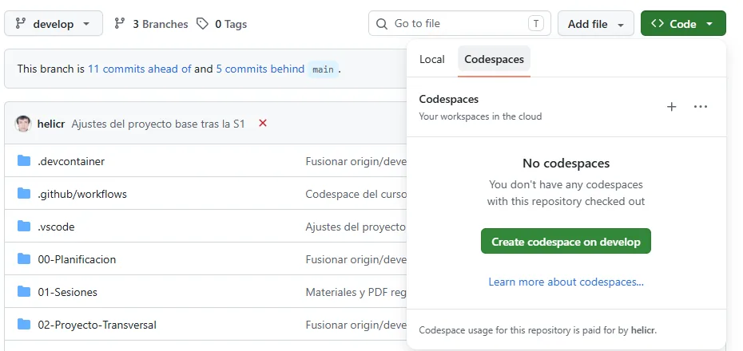

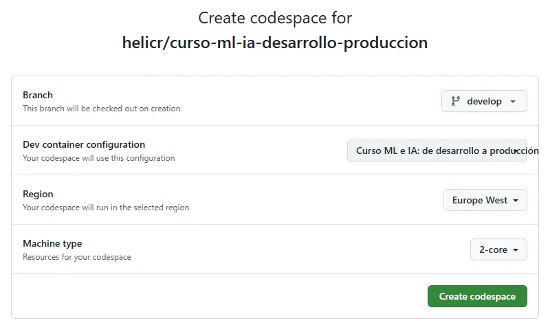

## Mientras se crea… y el primer aviso

Mientras se construye, abajo a la izquierda pone «Abriendo remoto…» (la primera vez, unos 3 minutos). No cierres la pestaña. Cuando conecta, pasa a decir «Codespaces: <nombre>» y aparece el Explorador con las carpetas del curso.

VS Code pregunta **«¿Confía en los autores de los archivos de esta carpeta?»**. Es el repositorio del curso: pulsa **Confiar en la carpeta y continuar**. Sin eso, la terminal no se abre (modo restringido).

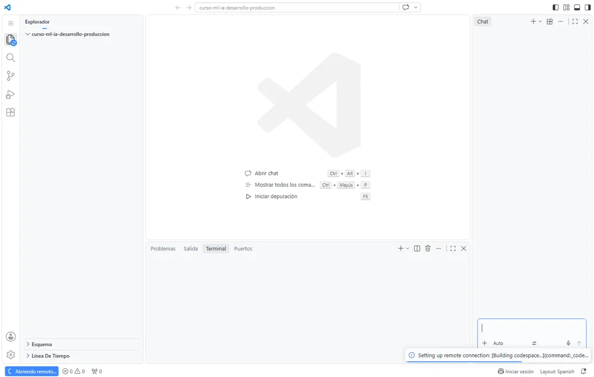

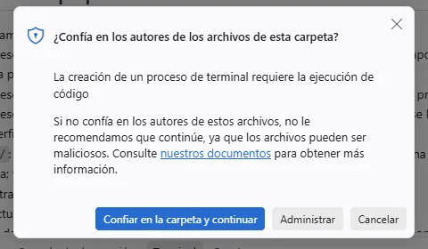

## Qué se prepara mientras esperas

| En `.devcontainer/` | Qué consigue |
|---|---|
| `image: mcr.microsoft.com/devcontainers/miniconda:3` | Linux con conda, como en tu equipo. |
| `docker-in-docker:2` con `"moby": false` | Un motor Docker propio dentro del Codespace: `docker build` y `docker run` sin instalar nada. |
| `kubectl-helm-minikube:1` | `kubectl` (para S3). |
| `postcreate.sh` | Instala `kind` y crea `env-ia-mlops` con las versiones del curso, y ejecuta `verificar.sh`. |
| `forwardPorts: [8080, 5000]` | Reenvía la API («API ia-mlops (S2)») y MLflow («MLflow UI»). |
| `extensions` | Python, Jupyter, Docker, Kubernetes, GitHub Actions y un visor de SQLite. |

**Lo que comprueba al terminar** (registro de creación real, 12/11/2026):

```text
[OK   ] docker       cliente 29.9.3 · servidor 29.9.3
[OK   ] hello        Unable to find image 'hello-world:latest' locally
[OK   ] kind         kind v0.27.0 go1.23.6 linux/amd64
[OK   ] kubectl      Client Version: v1.37.2
[OK   ] python       Python 3.11.18
Fallos: 0
```

La terminal se abre en la raíz del repositorio y con `(env-ia-mlops)` activado: entra con `cd 04-Proyecto-Base`. Tú no editas estos archivos. Si fallan, GitHub abre el Codespace en modo recuperación.

## Orientarte y comprobar Docker
*B · Abrir el Codespace · paso 2 de 8 · Probado en un Codespace real · 12/11/2026*

**En:** la terminal del Codespace

Cuando termine de prepararse, abre una terminal y comprueba lo mínimo antes de seguir.

1. Abre la terminal: menú **☰ → Terminal → Nuevo terminal** (<i>New Terminal</i> si está en inglés). Los comandos se ejecutan **en el Codespace**, no en tu equipo.
2. El indicador debe empezar por `(env-ia-mlops)`, como en tu equipo.
3. Junto a la terminal verás la pestaña **Puertos** (<i>PORTS</i>): la usaremos después.

```bash
cd 04-Proyecto-Base
python --version
docker version
```

**Debe salir.** `Python 3.11.18`. `docker version` debe mostrar dos bloques: **Client** y **Server** (en el Codespace de prueba, Docker Engine Community 29.9.3). Sin Server, Docker no ha arrancado.

**Si falla:**
- El indicador dice `(base)` en vez de `(env-ia-mlops)`: `conda activate env-ia-mlops`.
- `docker: command not found`: la configuración no se aplicó. Paleta de comandos (**F1**) → **Codespaces: Rebuild Container**.
- Solo aparece Client o dice `Cannot connect to the Docker daemon`: repite al cabo de un minuto; si sigue, reconstruye el contenedor.
- Sigue sin ir: usa el bloque 5 (Actions), que construye la imagen por ti, y **anota el mensaje exacto**.

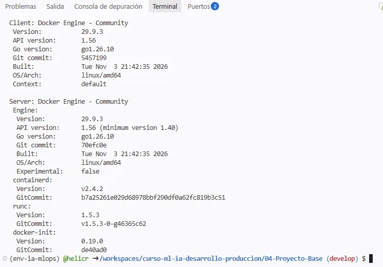

## En el navegador o en tu VS Code: el mismo Codespace

**VS Code en el navegador.** Es lo que se abre por defecto al crear un Codespace en GitHub. No instalas nada. Se reabre desde `github.com/codespaces`.

**VS Code de escritorio.** Tu VS Code conectado al Codespace; requiere VS Code 1.51 o posterior y la extensión **GitHub Codespaces**. El código sigue ejecutándose en el Codespace (Docker incluido).

Para S2 sirve cualquiera: los comandos y la cuota son los mismos. Puedes abrir el mismo Codespace desde cualquiera de los dos.

## Conectar desde tu VS Code de escritorio
*B · Abrir el Codespace · paso 3 de 8 · opcional · Según la doc. de GitHub · sin probar en un Codespace*

**En:** VS Code (instalado en tu equipo)

Una sola vez: instalar la extensión e iniciar sesión. Después, cada Codespace aparece en una lista.

1. Extensiones (**Ctrl+Shift+X**) → busca e instala **GitHub Codespaces** (`GitHub.codespaces`).
2. Pulsa el icono **Remote Explorer** de la barra de actividades e inicia sesión con GitHub: pulsa **Authorize** cuando se pida (y, si el navegador lo muestra, <i>Authorize Visual-Studio-Code</i>).
3. En la lista aparecen tus Codespaces: sitúate sobre el del curso y pulsa el icono del enchufe (<i>Connect to Codespace</i>).
4. Alternativa, desde `github.com/codespaces`: menú **⋯** del Codespace → abrir en **Visual Studio Code**.

```bash
gh codespace code
```

**Debe salir.** VS Code se reabre **conectado**: el Explorador muestra las carpetas del repositorio y la terminal integrada es la del Codespace (la ruta empieza por `/workspaces/`). Todo lo demás de la guía es igual.

**Si falla:**
- No aparece ningún Codespace: inicia sesión con **la misma cuenta** con la que lo creaste.
- La extensión no se instala o VS Code es anterior a la 1.51: actualiza VS Code o trabaja en el navegador.
- Equipo corporativo sin permiso para extensiones: usa el navegador, que no necesita nada.


# C · Laboratorio de S2

## Qué haremos dentro del Codespace

1. **Comprobar Docker** (`docker version`): Client y Server.
2. **Entrenar** el modelo (`python -m ia_mlops.pipeline`): la imagen necesita `models/`.
3. **Construir la imagen** `retencion-api:local` con el Dockerfile del proyecto.
4. **Arrancar el contenedor** y preguntarle a `/listo`.
5. **Comparar** las predicciones del contenedor con las del paquete, joblib y MLflow.
6. **Inspeccionar**: registros (`docker logs`) y usuario (`id -u`, no root).
7. **Limpiar**: borrar el contenedor.

**Preguntas para pensar:** ¿cuánto ocupa la imagen? Si cambias una línea de `ia_mlops/` y vuelves a construir, ¿qué capas se reutilizan? ¿Por qué el contenedor escucha en `0.0.0.0` y no en `127.0.0.1`?

## Entrenar el modelo en el Codespace
*C · Laboratorio de S2 · paso 4 de 8 · Probado en un Codespace real · 12/11/2026*

**En:** la terminal del Codespace, en 04-Proyecto-Base

La imagen copia `models/modelo_mlflow/`, y esa carpeta no viaja con el repositorio: se genera. Por eso se entrena aquí antes de construir.

```bash
python -m ia_mlops.pipeline
```

**Debe salir.** Termina sin error y deja en `models/` el modelo (`modelo_mlflow/`, `modelo.joblib`) y `metadatos.json`. En el Codespace tardó 31 s. Últimas líneas:

```text
  referencia_sin_aprender    AUC valid 0.500 | test 0.500 | precision media test 0.404
  regresion_logistica        AUC valid 0.698 | test 0.747 | precision media test 0.659
  gradient_boosting          AUC valid 0.663 | test 0.735 | precision media test 0.648
  Mejor modelo: regresion_logistica. Guardado en …/models/modelo.joblib
  (7.2 s)
```
*Salida real en Linux (2026-11-10), ruta recortada (…); en el Codespace, el mismo modelo. Los avisos WARNING de MLflow son normales.*

**Si falla:**
- `ModuleNotFoundError`: la terminal no está en el entorno del curso. `conda activate env-ia-mlops` y repite.
- `No module named ia_mlops`: no estás en `04-Proyecto-Base` (`pwd`).

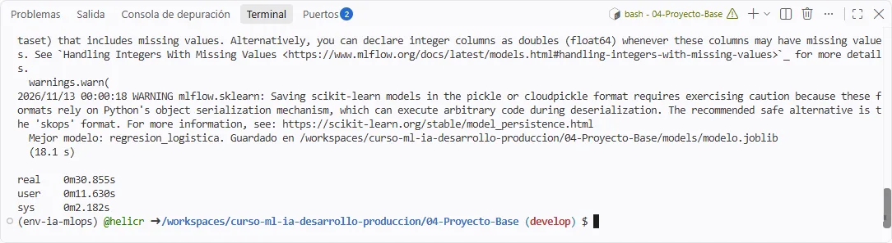

## Construir la imagen
*C · Laboratorio de S2 · paso 5 de 8 · Probado en un Codespace real · 12/11/2026*

**En:** la terminal del Codespace, en 04-Proyecto-Base

Docker lee el Dockerfile y crea la imagen `retencion-api:local`: Python 3.11, las dependencias fijadas, el paquete y el modelo, sin root.

```bash
docker build -f deploy/docker/Dockerfile -t retencion-api:local .
docker image ls retencion-api:local
```

**Debe salir.** El build termina con `FINISHED` (la primera vez, 78 s en el Codespace; si repites, las capas sin cambios salen de la caché). `docker image ls` lista `retencion-api:local`: con Docker 29 las columnas son **DISK USAGE** (826MB, lo que ocupa en disco, igual que en GitHub Actions) y **CONTENT SIZE** (183MB, comprimida).

**Si falla:**
- `COPY failed … models/modelo_mlflow`: falta entrenar. Ejecuta antes `python -m ia_mlops.pipeline`.
- `docker: command not found` o no conecta con el daemon: vuelve a «Orientarte y comprobar Docker».
- Un error al descargar la imagen base: repite; si persiste, anótalo y usa el bloque 5 (Actions).

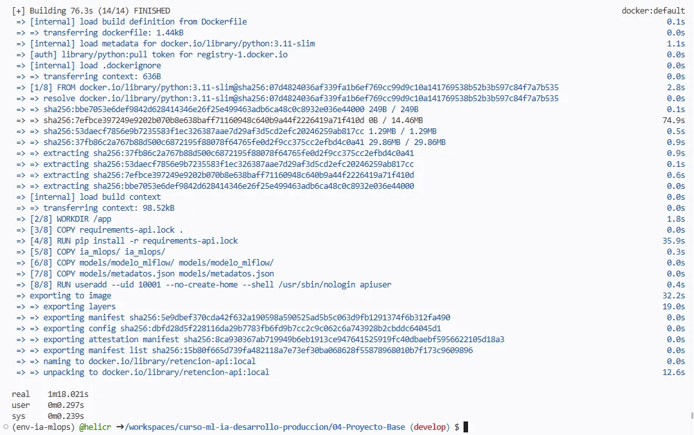

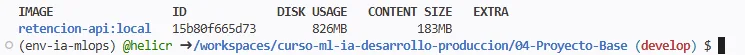

## Arrancar el contenedor y comparar
*C · Laboratorio de S2 · paso 6 de 8 · Probado en un Codespace real · 12/11/2026*

**En:** la terminal del Codespace, en 04-Proyecto-Base

`-p 8080:8080` publica el puerto del contenedor en el Codespace. `-d` lo deja en segundo plano.

```bash
docker run -d --name api -p 8080:8080 retencion-api:local
curl http://127.0.0.1:8080/listo
python -m ia_mlops.modeling.comparar --url http://127.0.0.1:8080
```

**Debe salir.** `curl` responde `{"estado":"listo"}`. La comparación termina con «Todos los caminos dan la misma probabilidad», y la última fila es **la API** (el contenedor):

```text
100 filas reales de la particion test · tolerancia 1e-09
camino                                    filas     diferencia maxima  resultado
paquete (referencia)                        100             0.000e+00  coincide
joblib                                      100             0.000e+00  coincide
MLflow                                      100             0.000e+00  coincide
API http://127.0.0.1:8080                   100             0.000e+00  coincide
Todos los caminos dan la misma probabilidad.
```
*Salida real en Linux con la API sin contenedor; en el Codespace, contra el contenedor, dio lo mismo (captura). Según la versión de MLflow puede aparecer antes una línea INFO: es informativa.*

**Si falla:**
- `port is already allocated` o `container name "/api" is already in use`: `docker rm -f api` y repite.
- `/listo` da 503: lee el campo `detalle` (falta el modelo o el esquema no coincide).
- La comparación dice `No se pudo comparar`: falta el modelo o la base; ejecuta el pipeline.

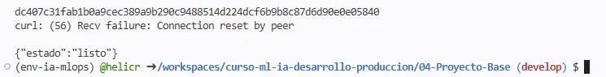
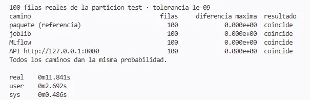

## Ver la API en el navegador (puertos)
*C · Laboratorio de S2 · paso 7 de 8 · opcional · Probado en un Codespace real · 12/11/2026*

**En:** el Codespace, panel PORTS

Con `curl` no necesitas esto: `127.0.0.1:8080` ya es el Codespace. Los puertos sirven para abrir `/docs` en tu navegador.

1. Abre el panel **Puertos** (<i>PORTS</i>), junto a la terminal. Con el contenedor en marcha lista el **8080** como «API ia-mlops (S2)» con un punto verde.
2. Si no aparece: **Agregar puerto** (<i>Add port</i>) → `8080`.
3. Abre la dirección reenviada (`https://<tu-codespace>-8080.app.github.dev`; icono del globo o clic derecho → abrir en el navegador) y añade `/docs`.
4. Verás la página interactiva de la API: prueba `/salud`, `/listo`, `/modelo` y `/predecir`.

**Debe salir.** La página de documentación de la API, servida **desde el contenedor**. La visibilidad del puerto debe ser **privada** (columna «Visibilidad»: <i>Private</i>): solo tu cuenta de GitHub puede abrirla. Cada visita aparece después en `docker logs api`.

**Si falla:**
- No carga: comprueba que el contenedor sigue vivo (`docker ps`) y que el puerto es el 8080.
- **No pongas el puerto en «Public»**: cualquiera con la dirección llegaría a la API, que no tiene autenticación.

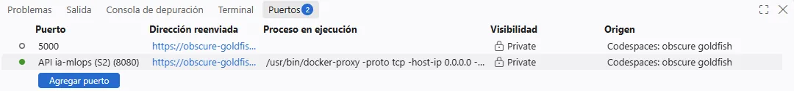

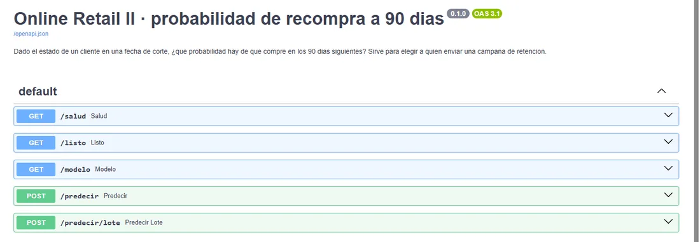

## Inspeccionar el contenedor y limpiar
*C · Laboratorio de S2 · paso 8 de 8 · Probado en un Codespace real · 12/11/2026*

**En:** la terminal del Codespace

Los registros salen por la salida estándar del contenedor; el usuario demuestra que no corre como root.

```bash
docker logs api
docker exec api id -u
docker rm -f api
```

**Debe salir.** `docker logs`: una línea JSON por petición (método, ruta, código, milisegundos e id). `id -u` imprime **10001**, no 0. `docker rm -f api` escribe `api` y libera el nombre y el puerto.

**Si falla:**
- `container … is not running`: el contenedor murió. `docker logs api` dice por qué (p. ej., sin modelo).
- Si quieres repetir desde cero: `docker rm -f api` y vuelve a «Arrancar el contenedor».
- Para la tarea, pega estas salidas en la plantilla de evidencias de S2.

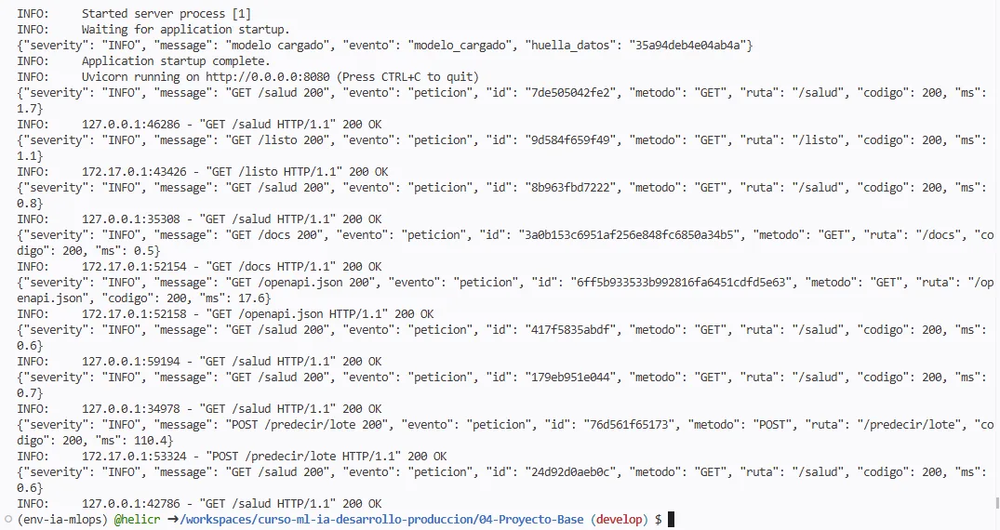

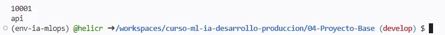


# D · Cuidarlo

## Guardar tu trabajo: el Codespace es temporal

En S2, bloque 4, no hay nada que guardar: lo que te llevas son las salidas, que copias a la plantilla de evidencias (`01-Sesiones/S2-API-y-Docker/evidencias/`).

- El repositorio del curso es de solo lectura para ti: al hacer tu primer commit o push, GitHub crea un **fork** en tu cuenta y enlaza el Codespace a él. Si borras ese fork, se borran los Codespaces enlazados.
- Si no puedes abrir el Codespace (por ejemplo, cuota agotada): en `github.com/codespaces`, menú ⋯ del Codespace → **Export changes to a branch**.
- Activa Auto Save, haz commit y push de lo que importe antes de borrar el Codespace y nunca guardes contraseñas ni tokens en él.

## Parar y borrar: cuida tu cuota

1. **Páralo.** Cerrar la pestaña no lo para: sigue gastando hasta agotar el tiempo de inactividad. Paleta de comandos (F1) → *Codespaces: Stop*, o `gh codespace stop`, o ⋯ → Stop en `github.com/codespaces`.
2. **Se para solo.** Sin actividad, a los 30 minutos (por defecto); configurable de 5 minutos a 4 horas en *Settings → Codespaces → Default idle timeout*.
3. **Bórralo.** Parado y sin usar se borra solo a los 30 días (configurable de 0 a 30; con 0 se borra en cuanto se para y pierdes lo no guardado). Al terminar una práctica: ⋯ → Delete en `github.com/codespaces`.

El disco cuenta mientras el Codespace exista, aunque esté parado, y borrarlo no devuelve el disco que ya contó este mes. *Cifras leídas en la documentación de GitHub el 10/11/2026.*

## Parar (o borrar) desde github.com/codespaces

En `github.com/codespaces`, menú ⋯ del Codespace: **Stop codespace**, **Export changes to a branch**, abrir en el navegador o en VS Code… (Delete está más abajo). Al pararlo aparece «Codespace … stopped»: ya no gasta cómputo, pero su disco sigue contando hasta que lo borres.

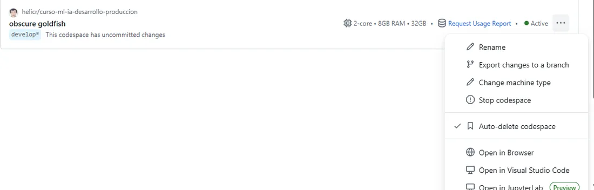

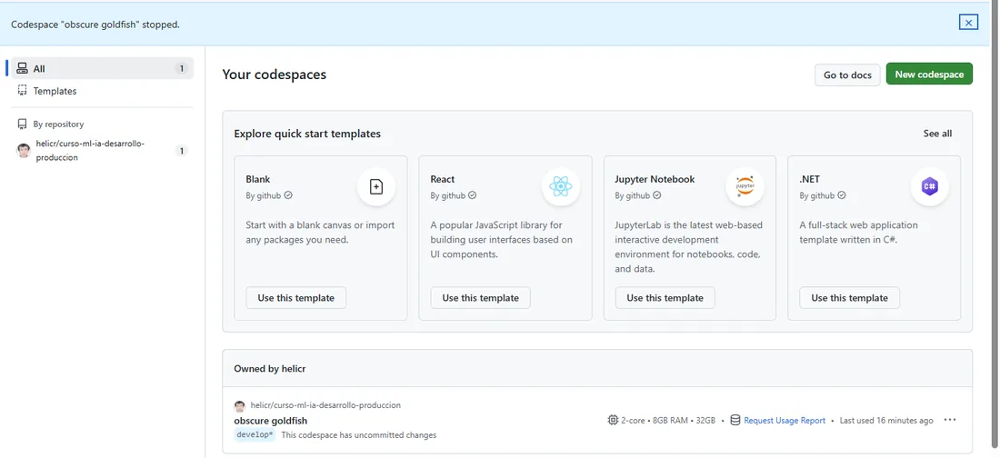

## Si algo falla

| Lo que ves | Causa | Qué hacer |
|---|---|---|
| «This codespace is currently running in recovery mode…» | El contenedor no se pudo construir con la configuración. | **View creation log** y anota el error; avisa al instructor. Tras corregirlo: **F1 → Codespaces: Rebuild Container**. |
| «¿Confía en los autores de los archivos de esta carpeta?» | VS Code abre las carpetas nuevas en modo restringido. | Es el repositorio del curso: **Confiar en la carpeta y continuar**. |
| El indicador dice `(base)` | La terminal no está en el entorno del curso. | `conda activate env-ia-mlops` |
| «Maximum running codespaces reached» | Tienes otro Codespace encendido. | Páralo en `github.com/codespaces` (⋯ → Stop codespace). |
| `docker: command not found` / `Cannot connect to the Docker daemon` | Docker no está disponible o no ha arrancado. | Repite al cabo de un minuto; <i>Rebuild Container</i>; si no, bloque 5 (Actions). |
| `COPY failed … models/modelo_mlflow` | Falta entrenar. | `python -m ia_mlops.pipeline` y vuelve a construir. |
| `Connection reset by peer` justo tras `docker run` | La API aún está arrancando. | Espera unos segundos y repite el `curl`. |
| `port is already allocated` / `name "/api" is already in use` | Queda un contenedor anterior. | `docker rm -f api` |
| El Codespace aparece parado o la pestaña pide reconectar | Se agotó el tiempo de inactividad. | Reábrelo desde `github.com/codespaces`; si no lo has borrado, sigue ahí. |
| No te deja crear uno | Cuota agotada, cuenta de organización o política. | Revisa tu uso; trabaja en pareja o usa el CI (bloque 5). |

Siempre: copia el mensaje completo como texto y envíalo con el comando que ejecutaste. Nunca envíes contraseñas, tokens ni capturas con tu sesión abierta.

## Así se ve el modo recuperación

Le pasó al propio curso la primera vez que se abrió (12/11/2026): la imagen base había cambiado y la configuración de Docker ya no servía. Ya está corregido. Si te ocurre: **View Creation Log**, copia las líneas con `ERROR` y envíaselas al instructor; mientras tanto, el bloque 5 (GitHub Actions) construye la imagen por ti.

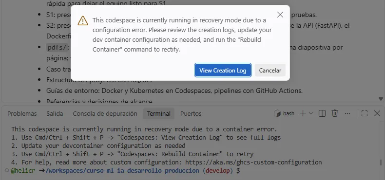


# E · Cierre

## Más allá de S2 y qué hacer si no puedes usarlo

**S3 (pendiente).** El programa prevé, si hay tiempo, un laboratorio acotado de Kubernetes en el Codespace. Las herramientas ya vienen: `kind` v0.27.0 y `kubectl` v1.37.2 (comprobadas el 12/11/2026). El laboratorio está por escribir y probar.

**Si no puedes usar Codespaces:** GitHub Actions (bloque 5 de S2: el workflow construye la imagen y prueba el contenedor; se verificó), trabajar en pareja, Cloud Shell de Google Cloud como respaldo (por verificar) o Docker Desktop en tu equipo (opcional).

## Qué se verificó y qué no

**Verificado.**
- Un Codespace real del curso (12/11/2026, 2 núcleos, rama `develop`): creación y conexión, `verificar.sh` sin fallos, el bloque 4 entero (pipeline 31 s, build 78 s, `/listo`, comparación, logs, `id -u` = 10001), el panel Puertos con `/docs`, el diálogo de confianza, el modo recuperación y parar desde la web.
- GitHub Actions: `docker build` con el Dockerfile (826 MB), `docker run`, `/listo`, `/modelo`, predicción, 422 al enviar `y` y usuario no root.
- Linux: pipeline (9 s con la muestra), API, `curl /listo` y la comparación entre caminos (las salidas en texto de esta guía).

**Sin probar.**
- La conexión desde VS Code de escritorio (paso 3).
- Las cuotas y los tiempos de inactividad y retención: salen de la documentación de GitHub (10/11/2026).
- Una cuenta de estudiante (región de EE. UU., cuota propia) y Export changes to a branch.
- Cloud Shell como respaldo y el laboratorio de Kubernetes de S3.

Si ves algo distinto de lo que muestra esta guía, envía el comando y el mensaje exacto.

## Fuentes

- Cuotas y precios de Codespaces: <https://docs.github.com/en/billing/concepts/product-billing/github-codespaces>
- Aprovechar el uso incluido (almacenamiento, tiempo de inactividad, retención): <https://docs.github.com/en/codespaces/troubleshooting/troubleshooting-included-usage>
- Ciclo de vida de un Codespace (30 min de inactividad, borrado automático): <https://docs.github.com/en/codespaces/about-codespaces/understanding-the-codespace-lifecycle>
- Borrado automático y periodo de retención (0–30 días): <https://docs.github.com/en/codespaces/setting-your-user-preferences/configuring-automatic-deletion-of-your-codespaces>
- Tiempo de inactividad configurable (de 5 min a 4 h): <https://github.blog/changelog/codespaces-now-have-a-configurable-idle-timeout>
- Crear un Codespace para un repositorio (rama, configuración, máquina): <https://docs.github.com/en/codespaces/developing-in-a-codespace/creating-a-codespace-for-a-repository>
- Máquinas disponibles (de 2 núcleos, 8 GB, 32 GB en adelante): <https://docs.github.com/en/codespaces/about-codespaces/what-are-codespaces>
- Usar Codespaces en Visual Studio Code: <https://docs.github.com/en/codespaces/developing-in-a-codespace/using-github-codespaces-in-visual-studio-code>
- Reabrir un Codespace (navegador, VS Code, gh codespace code): <https://docs.github.com/en/codespaces/developing-in-a-codespace/opening-an-existing-codespace>
- Reenviar puertos: <https://docs.github.com/en/codespaces/developing-in-a-codespace/forwarding-ports-in-your-codespace>
- Control de versiones y fork automático: <https://docs.github.com/en/codespaces/developing-in-a-codespace/using-source-control-in-your-codespace>
- Exportar cambios a una rama sin abrir el Codespace: <https://docs.github.com/en/codespaces/troubleshooting/exporting-changes-to-a-branch>
- Reconstruir el contenedor y modo recuperación: <https://docs.github.com/en/codespaces/developing-in-a-codespace/rebuilding-the-container-in-a-codespace>
- Student Developer Pack (180 horas y 20 GB de Codespaces): <https://github.com/education/students>
- Función docker-in-docker de los contenedores de desarrollo: <https://github.com/devcontainers/features/tree/main/src/docker-in-docker>

Consultadas el 10/11/2026. Las cuotas y los precios cambian: compruébalos en tu cuenta antes de la clase.

## Listo para el bloque Docker de S2 cuando…

- [ ] Mi cuenta de GitHub es personal y sé cuánta cuota me queda.
- [ ] He abierto el Codespace del curso (rama `develop`) y `docker version` muestra **Client** y **Server**.
- [ ] He entrenado con `python -m ia_mlops.pipeline` y he construido la imagen (o sé que usaré el CI).
- [ ] El contenedor responde en `/listo` y `id -u` da 10001.
- [ ] Sé parar el Codespace y borrarlo, y he revisado el tiempo de inactividad.

Lo ideal es abrir el Codespace antes de la clase: así, si algo falla, lo sabemos con tiempo.

---
*Este archivo lo genera `03-Entorno/guia-codespaces/generar.py`; no lo edites a mano.*
