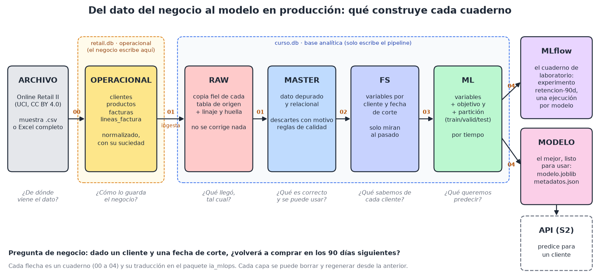

# Proyecto base: retención de clientes con Online Retail II

> Proyecto Python con la estructura de **Cookiecutter Data Science**. Los **cuadernos** son los pipelines; el paquete **`ia_mlops`**
> es su traducción a `.py`, la que se empaqueta, se prueba y se despliega. **S2** añade la API (`ia_mlops/api/`) y la imagen Docker.

**Pregunta de negocio:** dado un cliente y una fecha de corte, ¿volverá a comprar en los **90 días siguientes**?
**Dato:** Online Retail II (UCI, licencia CC BY 4.0), 1 067 371 líneas de una tienda online, 2009–2011. Ver `docs/modelo-de-datos.md` y `references/fuente.md`.

## Las capas, en este orden
```
OPERACIONAL (retail.db)  →  RAW  →  MASTER  →  FS  →  ML  →  ARTEFACTOS  →  SERVICIO (S2)
```


El dato nace en una **base operacional** simulada (`data/external/retail.db`, el sistema de ventas de la tienda) y el pipeline lo **ingiere** en la
base analítica (`data/processed/curso.db`). **FS va antes que ML:** ML se construye a partir de las variables de FS, más el objetivo y la partición.

| Capa | Cuaderno (el pipeline) | Pipeline `.py` (se ejecuta solo) | Lógica (módulos) | SQL |
|---|---|---|---|---|
| OPERACIONAL (simulación) | `00_pipeline_operacional` | `python -m ia_mlops.operacional` | `operacional.py` | `sql/operacional/` |
| RAW | `01_pipeline_raw_a_master` (1) | `python -m ia_mlops.pipeline_ingesta_raw` | `dataset.py` | `sql/raw/` |
| MASTER | `01_pipeline_raw_a_master` (2–4) | `python -m ia_mlops.pipeline_ingesta_master` | `dataset.py`, `calidad.py` | `sql/master/` |
| FS y ML | `02_pipeline_master_a_fs` y `03_pipeline_fs_a_ml` | `python -m ia_mlops.pipeline_ml` | `features.py`, `modeling/ml_dataset.py` | `sql/fs/`, `sql/ml/` |
| Entrenamiento y MLflow | `04_entrenamiento_y_seguimiento` | `python -m ia_mlops.pipeline_train` | `modeling/train.py` | |
| Predicción (base de la API) | | | `modeling/predict.py` | |
| **Servicio (S2)** | | `make api` | `ia_mlops/api/` | |

**Los cuatro pipelines son independientes e idempotentes** (`ia_mlops/control.py`). Cada uno comprueba que su entrada existe (si no, dice qué
ejecutar antes) y calcula una **huella de entrada** (datos que lee + su código + la configuración). Si coincide con la de su última ejecución
correcta, **no hace nada**; si cambió, reconstruye su capa desde cero. `--forzar` lo rehace siempre. Repetirlos no duplica nada, ni siquiera
ejecuciones en MLflow. `python -m ia_mlops.pipeline` solo los lanza en orden, por comodidad; en S4 los lanzará GitHub Actions.

## Estructura (Cookiecutter Data Science)
```
04-Proyecto-Base/
├── README.md · Makefile · pyproject.toml
├── data/
│   ├── raw/            muestra_online_retail_ii.csv (en el repo) y online_retail_ii/ (el original, se descarga)
│   ├── external/       retail.db: la base operacional simulada (se genera)   interim/   pasos intermedios
│   └── processed/      curso.db: la base analítica con las capas RAW a ML (se genera)
├── docs/               modelo-de-datos.md · de-notebook-a-python.md · api-y-contenedor.md · img/ (diagramas)
├── models/             modelo.joblib · modelo_mlflow/ · metadatos.json · mlflow.db (se generan)
├── notebooks/          los cinco cuadernos-pipeline (00 a 04)
├── references/         fuente del dato y licencia
├── reports/            metricas.json y figures/ (se generan)
├── sql/                esquemas (DDL) y scripts de inserción de cada capa
├── ia_mlops/           el paquete Python
│   ├── config.py · db.py · control.py · operacional.py · dataset.py · calidad.py · features.py
│   ├── pipeline_ingesta_raw.py · pipeline_ingesta_master.py · pipeline_ml.py · pipeline_train.py · pipeline.py (orquestador)
│   ├── modeling/       ml_dataset.py · train.py · predict.py · comparar.py (S2: compara los caminos hacia el modelo)
│   └── api/            la API de S2: esquemas.py (contrato) · servicio.py (modelo) · app.py (FastAPI) · registro.py (logs)
├── deploy/             docker/Dockerfile · github-actions/ci.yml (S2) · cloud-run y kubernetes (S3 y S4)
├── requirements-api.txt · requirements-api.lock · requirements-dev.txt     lo que instala la imagen y lo que instala el CI
├── .dockerignore · .devcontainer/     qué deja fuera la imagen · Codespace con Python 3.11 y Docker (sin probar)
└── tests/              equivalencia cuaderno = paquete, idempotencia de los pipelines, API e imagen
```

## Empezar (con el entorno `env-ia-mlops` activo, desde esta carpeta)
```text
pip install -e .                                   # instala ia_mlops en modo editable (una vez)
python -m ia_mlops.operacional                     # simula la base de ventas retail.db con la muestra (una vez)
python -m ia_mlops.pipeline                        # los cuatro pipelines en orden (segundos)
python -m ia_mlops.pipeline                        # otra vez: «sin cambios» en los cuatro
python -m ia_mlops.pipeline_train --forzar         # uno solo, forzado
```
Los **cuadernos** (el camino de S1): ábrelos en VS Code con el kernel `env-ia-mlops` y ejecútalos **en orden, del 00 al 04**. El 00 explica
todo el recorrido. Desde la terminal:
```text
papermill notebooks/00_pipeline_operacional.ipynb salida00.ipynb -p FUENTE muestra
papermill notebooks/01_pipeline_raw_a_master.ipynb salida01.ipynb
```
Con el dato **completo** (1,07 millones de filas, unos 2 minutos):
```text
python -m ia_mlops.dataset descargar               # baja el Excel de UCI y verifica su huella sha256
python -m ia_mlops.operacional --fuente completo   # el operacional cambia...
python -m ia_mlops.pipeline                        # ...y los pipelines lo detectan y rehacen todo
```
`make` hace lo mismo con atajos (`make operacional`, `make pipeline`, `make raw`, `make master`, `make ml`, `make train`, `make notebooks`, `make test`, `make traducir`, y desde S2 `make api`, `make comparar`, `make imagen`, `make contenedor`, `make lock`). En Windows no hay `make`: ejecuta las líneas `python` y `papermill` del `Makefile`.

## De cuaderno a Python
Dos caminos, y las pruebas exigen que den **el mismo resultado**: ver `docs/de-notebook-a-python.md`.
1. **Traducción literal** con jupytext: `make traducir` deja un `.py` por cuaderno en `scripts_desde_notebooks/`.
2. **Refactorización** a funciones con nombre, rutas configurables y registro: es el paquete `ia_mlops`.

## La API y la imagen (S2)
```text
python -m ia_mlops.pipeline                 # deja models/modelo_mlflow/ y models/metadatos.json
make api                                    # http://127.0.0.1:8080/docs
curl http://127.0.0.1:8080/predecir ...     # ver docs/api-y-contenedor.md
docker build -f deploy/docker/Dockerfile -t retencion-api:local .      # en Codespaces
```
Cinco endpoints (`/salud`, `/listo`, `/modelo`, `/predecir`, `/predecir/lote`), un contrato que sale de la **firma del modelo MLflow**, errores 422/503/500 distinguibles,
registros JSON por la salida estándar y una imagen mínima que no corre como root. Todo explicado, con lo que se probó y lo que no, en `docs/api-y-contenedor.md`.

## Pruebas
```text
python -m pytest tests                  # todas (incluye ejecutar los cuadernos)
python -m pytest tests -m "not lento"   # sin ejecutar los cuadernos
```
Comprueban, entre otras cosas: que el operacional reconstruye cada fila del archivo, que RAW es copia exacta del operacional, que `raw = master + descartes`, la integridad referencial, que **FS no usa información del futuro**, que la partición es temporal y sus
ventanas no se solapan, que el objetivo se recalcula igual con pandas, que los cuadernos y el paquete producen **las mismas tablas y las mismas métricas**, y que los cuadernos
traducidos a `.py` con jupytext también. Desde S2: que la API devuelve **la misma probabilidad** que el paquete, el `joblib` y el modelo MLflow, que su esquema coincide con la firma del
modelo, que rechaza lo imposible y avisa de lo no visto, que no filtra detalles internos en un 500 ni datos de clientes en los logs, y que la imagen contiene solo lo necesario.

## Resultados con el dato completo
| Modelo | AUC en test | Aciertos entre el 10 % con más probabilidad |
|---|---|---|
| Referencia sin aprender (tasa base 38 %) | 0,500 | 34 % |
| **Regresión logística** | **0,796** | **90 %** |
| Gradient boosting | 0,781 | 88 % |

La tasa de recompra cambia entre periodos (48 % en train, 35 % en valid, 38 % en test): es el punto de partida para hablar de **deriva** en S5.
Las cifras salen de `reports/metricas.json` tras ejecutar el pipeline completo.

## Estado
S1 usa los cinco cuadernos y los cuatro pipelines. **S2** (esta versión) añade la API y el Dockerfile. S3 migra el caso a GCP y despliega esta misma imagen en Cloud Run (`deploy/cloud-run`; Kubernetes, en `deploy/kubernetes`, como laboratorio en Codespaces); S4 orquesta la construcción, publicación y despliegue con GitHub Actions (y los pipelines, cada uno como un paso); S5 añade versionado de modelos con alias, deriva, monitoreo y rollback.
